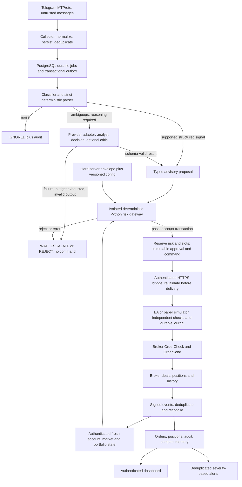
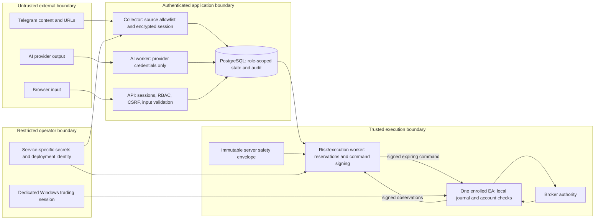
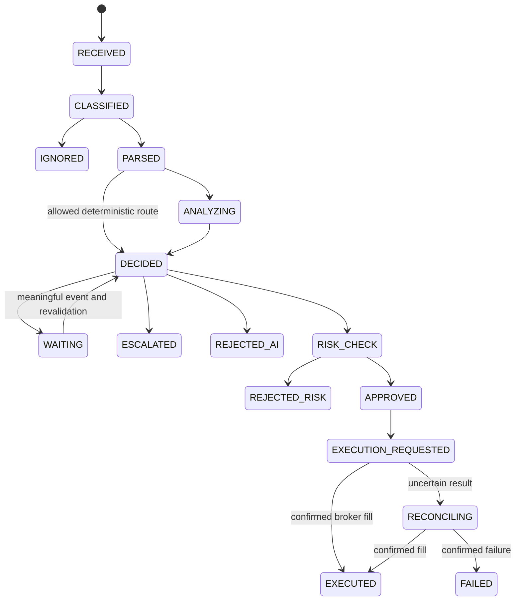
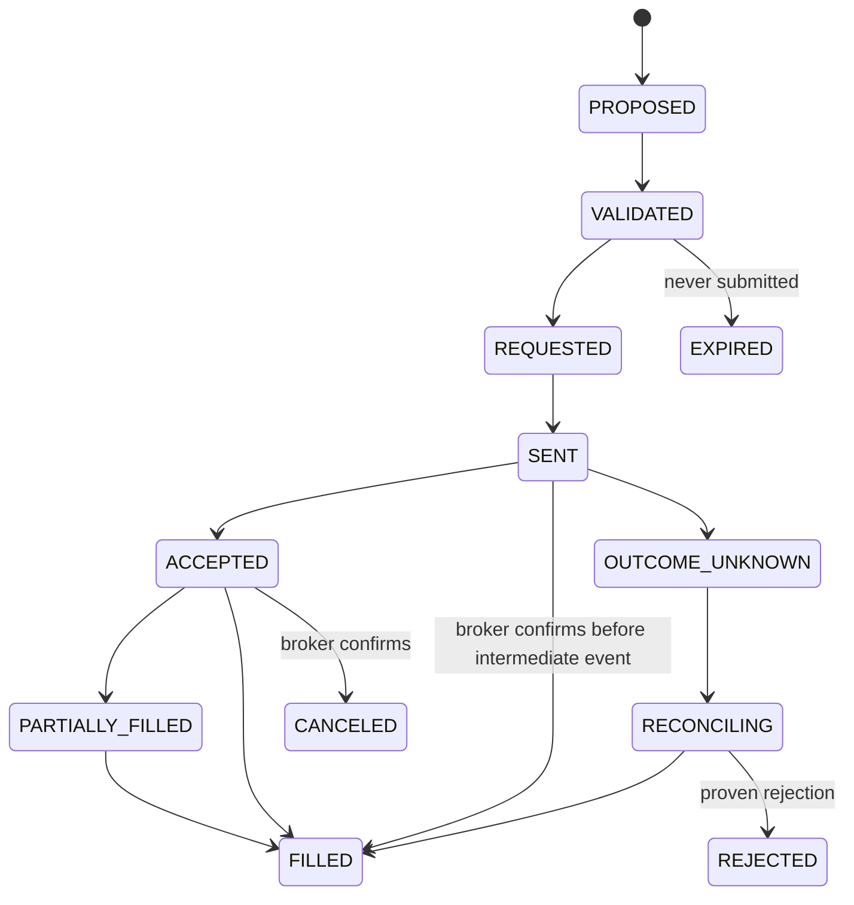

# Autonomous trading orchestration architecture

Status: approved direction, phases 1–7 implemented within local paper acceptance.
Phase 7 wires the pure risk engine to authenticated synthetic observations, atomic
reservations, signed commands and a durable simulator. The local position extension
adds confirmed full closes, protective updates and controlled resume; native MT5 and
real broker acceptance remain future gates. [Paper bridge](PAPER_BRIDGE.md),
[phase 7 evidence](PHASE_7_VALIDATION.md), [position evidence](POSITION_MANAGEMENT_VALIDATION.md).
Vercel/OpenRouter preparation remains subject to real-host acceptance.
Research baseline: 2 October 2026. See [risk contract](RISK.md) and
[phase 6 evidence](PHASE_6_VALIDATION.md).
Later sections describe future risk/execution capabilities, not completed features
or production certification. See [deployment](DEPLOYMENT_VERCEL.md),
[OpenRouter acceptance](OPENROUTER.md), [approval](PHASE_0_APPROVAL.md),
[environment](ENVIRONMENT.md), [threat model](THREAT_MODEL.md) and [ADRs](adr/README.md).

## 1. Final architectural choice

Use one Python modular monolith with independent process entrypoints, one Next.js dashboard, PostgreSQL, and optional Redis. Share domain contracts and release versions; separate credentials, database permissions and runtime identities. No Kubernetes, Kafka, Celery, broker credentials in the backend, browser automation for ingestion, autonomous prompt rewriting, or continuous LLM polling.

| Layer | Proposed baseline | Responsibility |
| --- | --- | --- |
| Dashboard | Next.js 16.3.8 App Router; React/React DOM 19.3.0; strict TypeScript; Node 24 LTS; pnpm | Authenticated control center; no trading authority or provider secrets |
| Design system | Astryx core/CLI and neutral theme 0.6.4; StyleX 0.19.0; validated SWC plugin/Webpack path | Official component/layout contracts; dark default with readable status labels |
| API | Python 3.13; FastAPI; Pydantic v2; Uvicorn | Authentication, queries and confirmed administrative requests |
| Persistence | PostgreSQL 17; SQLAlchemy 2.0; psycopg 3; Alembic | Durable state, leases, outbox, reservations, replay claims, sessions, audit |
| Workers | Same Python package, separate entrypoints/permissions | Ingestion, AI orchestration, deterministic risk/execution, maintenance/notifications |
| Telegram | Telethon/MTProto | Collector with encrypted durable session and reconnect |
| AI | Mock default; OpenRouter gated network adapter | Schema-bound advisory results, immutable accepted profiles and conservative budgets |
| Execution | Isolated Python risk/bridge HTTP-worker entrypoint; native MQL5 EA; protocol simulator | Command signing, authenticated telemetry/replay, authoritative portfolio, reconciliation |
| Edge | Vercel Next BFF plus Cloudflare Access/Tunnel | Fixed origin, human MFA assertion, API service token and environment fence; bridge remains isolated |
| Redis | Optional development/cache dependency | Acceleration only; no exclusive queue, lock, session, replay or risk authority |

Exact package observations and source links live in [backend research](research/BACKEND.md) and [Astryx research](research/ASTRYX.md). A disposable Next/Astryx production build and custom StyleX CSS emission passed. Authored StyleX uses the tested community SWC plugin 0.19.0 with `next dev/build --webpack`; the custom Turbopack path remains untested. Version numbers are a dated research baseline. Phase 1 resolves exact locks and image digests, scans them, and runs runtime/build/migration checks; metadata alone is not backend compatibility certification. SQLAlchemy 2.0 is deliberately the maintenance baseline rather than a just-released 2.1 upgrade.

## 2. Deployment strategy

**Current selected topology:** dashboard and fixed administrative Next routes on
Vercel, persistent API/PostgreSQL/workers on Windows, portable to Linux. Development
remains local. Staging/production use separate PostgreSQL instances, credentials,
storage and provider accounts. Vercel preview cannot use production and requires an
approved staging hostname. API checks signed MFA-bearing human assertions, proxy key
and environment; BFF checks response environment. Password/session/RBAC/CSRF and
confirmed configuration remain authoritative. [Real-host acceptance](DEPLOYMENT_VERCEL.md)

**macOS development:** Docker Compose supplies PostgreSQL, optional Redis and containerized API/workers/dashboard. A host-development override disables duplicate application containers so `pnpm dev` and Python development entrypoints can use the same local services. A default paper simulator exercises the whole protocol. Fresh-install scripts create local random secrets, migrate, and bootstrap a non-live administrator without committed passwords. No MT5 is required for local paper development.

**Production A, conditional preference:** Windows Server 2022 Desktop Experience, provider-enabled nested virtualization, WSL2 Ubuntu, Docker Engine/Compose inside Ubuntu. Windows natively runs MT5/EA, RDP/browser, Caddy and cloudflared. A Windows boot supervisor under the WSL distribution owner starts and keeps WSL alive; container restart policies alone are insufficient. Never require Docker Desktop on Windows Server. Validate this topology before selecting it.

**Production B, native Windows:** Python virtual environment, PostgreSQL 17 Windows
services, pinned WinSW application services and native cloudflared. Use -BackendOnly
with independent service prefixes/ports when the dashboard is on Vercel. A Windows-built
Next standalone artifact remains an optional all-local alternative. Disable Redis and
use PostgreSQL adapters. No WSL, Docker Desktop, nesting, Gunicorn, uvloop or Celery dependency.

**Linux backend:** the backend Compose overlay supports explicit staging/production,
loopback ports, distinct project volumes and read-only acceptance mounts. It does not
move MT5 to Linux or certify an untested host. OpenRouter defaults off and requires
an expiring receipt, immutable profile import, positive budgets and confirmed selection;
no model output gains execution authority. [OpenRouter contract](OPENROUTER.md)

Server 2022 is the first target to match the observed PostgreSQL 17 Windows installer test matrix. Server 2025 requires its own native PostgreSQL/version verification, or the conditional WSL path. Architecture is portable; deployment support is earned through tests.

Backend services must return before interactive login after reboot. MT5 is a desktop process, so the secure default requires a trading-user login, then reconciliation, before new trades resume. Optional dedicated-user Autologon followed by desktop locking is a later explicit security decision. This default supports unattended operation while the terminal session remains running; it does not promise hands-free GUI recovery after every reboot. [Windows research and official references](research/WINDOWS.md)

## 3. Data flow



The simple deterministic route is allowed only for explicitly supported grammars, complete normalized fields, configured source permission and a versioned route policy. A required analyst/critic never becomes optional because cost, latency or availability is inconvenient. The AI decision is an advisory proposal, never an executable command.

## 4. Trust boundaries and privileges



The AI worker cannot write reservations/approvals/commands and has no bridge keys or broker credentials. The collector cannot change risk settings. The normal API can request a confirmed soft-config change or emergency action but cannot mint trade approval or write authoritative account/equity/position snapshots. Only the risk/execution role creates exposure-increasing commands. Its separate local bridge HTTP entrypoint owns inbound HMAC keys, replay verification, authenticated telemetry and authoritative projections, as well as dynamic signed responses. Keep this entrypoint outside the external dashboard route. It shares the monolith's package/release, not the API's credentials. Browser, AI and Telegram inputs are validated again at each relevant boundary.

Use separate least-privilege database/service accounts for migrations/bootstrap, API, collector, AI orchestration, risk/execution and maintenance. Read models expose redacted fields. Operational session/bridge replay secrets are readable only by their owners. The migration role is not a runtime credential. Do not give every Compose service the entire `.env` through one `env_file`.

The VPS administrator, deployed code, database administrator, risk signer and EA host are trusted. A host administrator can defeat local controls. Separate processes/roles constrain accidental and lower-privilege compromise; a single VPS is not a hardware-isolated security enclave. This boundary is explicit in the threat model.

## 5. Configuration and invariant enforcement

Effective authority is the intersection of **hard server bounds → reviewed server policy → versioned dashboard settings → advisory agent proposal**. A later layer may tighten limits, never expand its authority beyond an earlier layer. Hard limits and live authorization are read from execution-service configuration, have no dashboard mutation endpoint, and are validated at startup. Invalid or absent safety configuration prevents execution.

Settings changes require ADMIN, confirmation bound to the change digest, expected version, session and expiry, and an atomic new version plus audit event. Optimistic concurrency rejects stale edits. Tighter limits, source disablement and pause invalidate unsent approvals. Track one monotonic safety epoch per execution account; delivery and the EA check current authority/expiry. A command already in flight cannot be recalled with a database update, so the UI reports this race and reconciliation resolves it.

Default `TRADING_MODE=paper`, `ENABLE_AUTOMATION=false`, `ENABLE_LIVE_TRADING=false`, pending orders off and optional critic/adaptive changes off. Demo is explicit and permits only enrolled DEMO login/server identities. Live requires independent server deployment permission, REAL-account allowlist, separate environment/keys, EA allow-live input and completed demo acceptance; a dashboard toggle cannot authorize live.

## 6. Deterministic risk contract

`RiskEngine.evaluate(proposal, account_state, market_state, effective_config)` returns a typed `PASS`, `REJECT` or `ERROR`, all reason codes, the calculation inputs/results, rules/config versions and snapshot identifiers. Missing data, unsupported financial profiles or exceptions return ERROR and produce no command. The domain risk engine is pure Python and uses Decimal; it has no framework, provider, database or broker side effects.

The surrounding gateway locks the execution account, rereads portfolio/reservations, evaluates, reserves risk and position slots, and persists approval/immutable command/outbox in one PostgreSQL transaction. This prevents concurrent signals independently spending the same budget. Before exposing a command at dispatch, rerun all applicable deterministic gates against current equity, daily loss, portfolio, metadata/quotes, config and health under the account lock, accounting for its own existing reservation exactly once. If the immutable approved request no longer passes, revoke it before delivery; do not change signed economics silently. Snapshot freshness alone is insufficient. Reserve outstanding/pending/uncertain exposure until confirmed resolution; lost acknowledgements do not release it.

| Rule family | Required inputs/behavior |
| --- | --- |
| Authority/health | Automation and source enabled, correct mode/account, complete reconciliation, healthy DB/worker/EA, fresh account/quote/metadata |
| Symbols/sessions | Exact broker-symbol mapping, allowed minus blocked instruments, approved source instruments, UTC/DST-aware session calendar and market-open state |
| Identity/time | Source/version/fingerprint uniqueness, aware UTC timestamp, maximum signal age, expiring proposal/command |
| Protective stops | Mandatory configured SL/TP; correct side/entry relationship, tick precision, stop/freeze constraints; unsupported attached-stop execution rejected |
| Per-trade risk | Account-currency potential loss at SL plus bounded conservative fee/slippage buffer; hard/soft/source caps; volume rounded down to broker step |
| Portfolio | All-account open risk plus reservations, position slots, symbol exposure and margin/leverage checks; unknown/unprotected external exposure pauses new trades |
| Drawdown | Persisted UTC day baseline, cash-flow adjustment and fees/swap; equity loss counts unrealized loss; threshold latches pause; resetting a latch never resets the baseline or bypasses reevaluation |
| Execution | Maximum lot, spread, allowed deviation and approved price band; unsupported contracts/conversions rejected |
| Policy/AI | Required agent/critic route completed with valid versioned result and thresholds; exhausted budgets never bypass reasoning |
| Failure/loss limits | Versioned consecutive-failure/loss counters and source-specific bounds when enabled |

No heuristic symbol suffix matching. Start with explicitly tested spot-FX contract profiles and a configured account currency; other CFDs/metals/crypto/futures stay rejected until their valuation/conversion implementation is tested. Effective leverage measures approved gross notional divided by equity with verified conversion; broker margin/OrderCheck is an additional preflight, not a substitute. Correlation exposure is deferred rather than falsely advertised. [MT5 risk and broker capability research](research/MT5.md)

Stop-based risk is a pretrade estimate, not a guaranteed maximum realized loss during gaps, slippage or broker failure. Include tests at, below and above every bound and for missing, negative, stale, malformed and conflicting data. No risk-increasing stop modification or pending placement bypasses the same gateway.

## 7. Execution semantics and state machines



Also permit explicit EXPIRED/FAILED transitions from defined active states and audit every transition. Escalation creates no automatic approval; any ADMIN resolution becomes a new proposal/version and still passes risk. Edits create immutable message/signal versions, invalidate unsent approvals and do not execute a second trade merely because the message changed. Updates/cancellations become targeted proposals against a known managed order/position.



Transport command delivery, broker order and position lifecycle are separate state machines. `COMMAND_RECEIVED`, `OrderCheck`, `OrderSend(true)`, SENT and ACCEPTED never mean EXECUTED. Preserve PARTIALLY_FILLED and uncertain outcomes; reorder-safe reducers consume broker evidence, not an assumed linear arrival sequence.

Use HTTPS outbound EA polling and signed event POSTs. Commands carry ID/trace, environment/account tuple, expiry, action, decimal strings, position identity, risk approval/reservation, config version, safety epoch, ownership generation, maximum spread/deviation and price band. Sign exact UTF-8 payload bytes plus fixed protocol headers with HMAC-SHA256; use separate purpose keys, durable request sequences, short validity, fixed HTTPS origins, replay claims and event ID/payload hashes. See [full protocol proposal](research/MT5.md).

EA persists command hash and a flushed SEND_INTENT before `OrderSend`, buffers trade observations without network calls in `OnTradeTransaction`, and acknowledges server events only after durable commit. A crash around a broker send is not transactionally atomic. Never auto-resubmit an uncertain SEND_INTENT; reconcile broker history/current state and retain reservations. There is no exactly-once broker guarantee. One active EA owns an account; replacement requires stopping the old instance and controlled reconciliation, not automatic lease takeover.

Separate modes share schema/protocol but not identities or credentials. The simulator cannot authenticate as a production EA. Initial EA commands: market open with attached required stops, validated SL/TP modification, targeted close. Partial close and pending operations are disabled until the chosen account/broker capability is tested. A dedicated automated account is recommended; mixed ownership in a netting position freezes automation.

## 8. AI, registry and memory

Contracts: `AIProvider`, `AIModel`, `AgentDefinition`, `AgentExecution`, `AgentResult`, `ModelRegistry`, `PromptVersion`. Domain consumes validated results, not provider SDK objects. Provider adapters implement timeouts, cancellation, typed structured output, refusal/error classification and usage/cost metadata. Mock is deterministic; OpenAI is the first real adapter; other provider modules conform later without being mandatory.

Logical agents: SIGNAL_CLASSIFIER, SIGNAL_PARSER, MARKET_ANALYST, DECISION_AGENT, optional CRITIC and event-driven POSITION_REVIEW_AGENT. The deterministic parser and route policy reduce calls. A position review requires a meaningful persisted event, cooldown and deduplicated job; continuous market monitoring uses code.

Registry entries are reviewed deployment manifests: exact provider/model ID, enabled state, supported output schema, reasoning options, maximum tokens, pricing version/currency and capabilities. Dashboard accepts only registry IDs and capability-appropriate choices. Agent configs have immutable versions, enabled state, primary/fallback registry references, timeout, token ceiling, maximum cost, thresholds and prompt version. Change validation detects disabled/invalid fallback chains and cycles. Missing/unsupported configuration fails closed. No secret or arbitrary model string field.

Before each provider attempt, atomically reserve worst-case priced token/request spend against daily/monthly/per-agent policy budgets. Cap output and total attempts across fallbacks; unknown pricing rejects a cost-capped call. Settle actual billed usage when available; retain conservative reservation on unknown outcome until reconciliation. Fallbacks must meet the same required reasoning/schema policy and budget. Pricing/cached-token uncertainty remains visible as estimated cost, never exact billing. Administrative notification is deduplicated on budget state change. Optional critic can be disabled on exhaustion only when route policy did not require it.

Every run records trace/signal, agent/config, provider/model, prompt checksum/version, input/output schema versions, route, latency, attempt/refusal/error, token counts and estimated cost. Treat Telegram text/URLs as quoted untrusted data; strict prompts deny policy/secret/tool authority. Providers get minimal redacted input, no execution tools and no arbitrary fetching. Raw prompts/responses expire; compact validated outputs/rationales remain where necessary for trade explanation. Do not request or retain private chain-of-thought.

Compact trade memory contains source, instrument, context summary, proposal, risk/execution outcomes, realized P&L/R multiple, model/prompt/rule versions. Aggregates are advisory and bounded; they do not self-change prompts, trust, strategy or risk. V1 ADMIN explicitly approves any proposal for a threshold/trust change.

## 9. Persistence and integrity

All tables use explicit primary keys, aware UTC timestamps, foreign keys and appropriate check/unique constraints. Financial columns use NUMERIC with documented precision; financial JSON/API values are decimal strings. Preserve native broker timestamps and conversion metadata separately. Accounts are identified by environment + broker server + login + mode. Do not assume broker ticket fits JavaScript's safe integer range.

| Tables | Purpose / key integrity |
| --- | --- |
| users, sessions, auth_attempts | ADMIN/VIEWER, Argon2 hashes, hashed opaque session IDs, expiration/revocation and shared throttling |
| system_settings, setting_versions, audit_events | Typed active config pointer; immutable versions; action/actor/redacted changes |
| telegram_sources, telegram_messages, telegram_message_versions | Collector identity + peer + message ID uniqueness; reply/edit relationships; body/hash retention |
| signals, signal_versions | Message-version linkage, route/state, immutable parsed proposal and decision versions |
| agents, agent_configs, model_registry, prompt_versions | Registry foreign keys, immutable config/prompt versions and checksum |
| agent_runs, ai_usage, ai_budget_reservations | Attempts, usage, pricing version, atomic spend reservations |
| risk_rules, risk_events, risk_approvals, risk_reservations | Hard/soft effective policy fingerprint, result codes and calculation evidence |
| trading_accounts, symbol_metadata, market_snapshots | Enrolled account identity and fresh broker-derived inputs |
| execution_commands, execution_events, orders | Immutable signed bytes, lifecycle, unique command/event/deal identities |
| positions, position_events | Current projection plus immutable economic observations, ownership and lifetime broker identity |
| system_health, heartbeats | Component availability/freshness, sanitized diagnostics and snapshot completeness |
| jobs, outbox_events, bridge_instances, bridge_replay_claims | Durable work leases, acknowledgements, fencing/replay evidence |
| compact_trade_memory, notification_deliveries | Outcome aggregates, severity/deduplication and delivery backoff |

Jobs use `FOR UPDATE SKIP LOCKED`, bounded leases and retries/dead-letter states. Commit business changes with outbox rows atomically. Retry delivery at least once; make handlers idempotent. Database loss stops new work and execution; expired jobs are reclaimable but broker sends are reconciled rather than retried. Redis loss switches only optional functions to PostgreSQL or reports degraded cache status. [PostgreSQL queue locking](https://www.postgresql.org/docs/17/sql-select.html)

Trade/config/security audit is append-only for runtime roles and contains no credentials. Optional chained hashes detect certain changes but do not defeat database-administrator rewriting; encrypted off-host backups/exports strengthen evidence. No claims of immutable external audit infrastructure in V1.

## 10. Authentication and dashboard

Local credentials with Argon2id; server-side opaque sessions stored as hashes in PostgreSQL. Production cookies are HttpOnly, Secure, SameSite=Lax, host-scoped and expiring. Enforce CSRF token plus Origin checks for cookie-authenticated mutations, login/logout protection, shared IP/account throttles and bounded backoff. RBAC on every backend route; VIEWER is read-only. Optional TOTP contract includes encrypted secret, one-use recovery codes and setup confirmation. Require MFA for external production access through Access initially; validate Access JWTs if using identity assertions.

Serve the API through the same origin; no permissive CORS. Render untrusted content as escaped text, with no raw HTML. Apply CSP compatible with built Astryx/StyleX styles, security headers, body limits and fixed egress endpoints. Normal dashboard exposes status and secret-presence booleans only. Emergency mutation endpoints require ADMIN and a single-use, short-lived confirmation bound to exact targets/state.

Use Astryx's discovered AppShell/SideNav, compact Table, Badge, Banner, Tooltip, Skeleton, form and confirmation components. Inspect current CLI contracts before each view. Adapt operational list/detail and settings templates rather than copying an analytics-card wall. Dark neutral palette; persistent PAPER/DEMO/LIVE indicator, status text/icons, heartbeat age, safety state and prominent emergency controls. No optimistic success toast for broker fills.

Required routes: overview, positions, signals/detail, agents/model registry, risk, sources, AI costs, settings and audit. Overview reports balance/equity/day P&L/open risk, all service freshness, automation gate/reasons, last signal/execution and errors. Position rows link source/signal/decision/broker identities. Signal detail explains route/version, risk reasons and confirmed/uncertain execution. AI cost pages distinguish estimated from known usage. Empty, loading, stale, unauthorized and error states are explicit; responsive tables provide focused mobile detail.

Pause new trades and disable automation invalidate unsent exposure. Cancel/close managed targets require a contextual confirmation showing account, mode, target count and expected state. Paused/drawdown state still permits explicitly authorized risk-reducing close/cancel on verified managed targets with authenticated execution and valid ownership. Contact loss relies on broker-held stops, not an impossible remote close.

## 11. Operations, retention and recovery

Structured JSON logs with trace/signal/command/run IDs, strict redaction and rotation by size/age. Default verbose/raw Telegram/AI retention: seven days. Cleanup nulls raw bodies while retaining identifiers/hashes and compact validated records; foreign-key anchors and evidence for open, pending or uncertain trades are protected. Long-term trades, compact memory and config/security audit have separate retention. Maintenance permissions cannot delete safety/replay/journal evidence prematurely. Retention jobs are leased, resumable and audited.

Liveness exposes minimal process status; authenticated readiness/operations exposes DB/schema, worker/collector/provider availability, replay/journal/reconciliation, heartbeat age, queue depth/lag, disk and optional memory. A fresh heartbeat alone is not account readiness. Providers are observed from configured requests/probes, never claimed healthy from key presence. New exposure fails closed on required-component degradation; telemetry/cache outage is graded by its safety relevance.

Notifications use a Telegram bot adapter behind an outbox, severity, incident key, cooldown and recovery transitions. Startup, degraded/disconnected, risk rejection, daily-loss latch, pause/kill, broker-confirmed execution, budget and live-mode events are supported. Never send secrets or raw private messages; notification failure does not invent execution success.

One VPS is a cost-efficient single point of failure. Backups require encrypted off-host storage selected at deployment, tested restore, schema/release records and restricted credentials. Restores never auto-enable automation; reconcile broker state, replay evidence and reservations first. Target RPO/RTO is agreed before deployment rather than claimed from an untested schedule.

## 12. Proposed repository layout

This is a proposal only; application directories have not been scaffolded.

```text
/
  apps/
    dashboard/                 Next.js + Astryx; generated API client
    api/                       FastAPI composition/entrypoint
    worker/                    orchestration and risk/maintenance entrypoints
    telegram/                  collector entrypoint
    simulator/                 paper EA protocol simulator
  backend/
    domain/                    schemas, state machines, pure risk/portfolio rules
    application/               use cases, ports, routing, transactions
    infrastructure/            DB, repositories, leases, outbox, security, logging
    api/                       routes, auth dependencies, DTOs
    ai/{providers,agents,prompts,routing}/
    trading/{risk,execution,portfolio}/
    integrations/{telegram,mt5,notifications}/
  packages/
    shared-types/              generated OpenAPI TypeScript; no duplicated rules
    config/                    public schemas and reviewed non-secret manifests
  mt5/AutonomousTraderEA/      MQL5 source, protocol fixtures, local journal
  migrations/                 Alembic revisions and seed/bootstrap commands
  infra/{docker,windows,scripts}/
  tests/{unit,integration,e2e,fixtures}/
  docs/{adr,research}/         architecture, security, operations and evidence
  .github/workflows/          Linux/Windows checks and release artifacts
  pyproject.toml, uv.lock, pnpm-workspace.yaml, pnpm-lock.yaml
  docker-compose.yml, docker-compose.dev.yml, .env.example
  README.md, task runner, .gitignore, .gitattributes
```

Python package boundaries avoid duplicate risk implementations: `domain` owns rules; `trading/risk` wires orchestration/adapters. `apps` contain entrypoints, not a second backend. Generated client types originate from versioned Pydantic/OpenAPI schemas; protocol fixtures verify Python/MQL representations. Use pathlib, UTC, explicit UTF-8 and platform-native service scripts; no macOS or POSIX assumptions in application code.

## 13. Phase sequence and acceptance

Phase 0 produces this architecture/security/env/ADR/evidence package and stops for approval. Phase 1 then creates reproducible monorepo infrastructure, runtime config validation, health, initial migration/bootstrap flow, Astryx smoke shell and CI; no real AI/Telegram/EA execution yet.

Later phases follow the user's 2–12 sequence. CI progressively covers pure parsing/risk/state/config/signature/retention unit tests, real PostgreSQL migrations and lease contention, optional Redis outage, mocked AI/Telegram, protocol simulator E2E, authenticated UI, duplicate/stale/timeout/unknown/restart failures, Linux and Windows compatibility. Use actual PostgreSQL for locking/NUMERIC tests rather than substituting SQLite semantics. Windows native EA compile, demo broker operations and pre-login reboot/restore are separate mandatory evidence gates. Simulator success never satisfies them.

At each phase: document changes/ADRs/risks, run scoped checks, record results, and commit logically separated changes when Git exists. No production-ready or Definition-of-Done claim until all applicable evidence gates pass. Live trading remains off.
