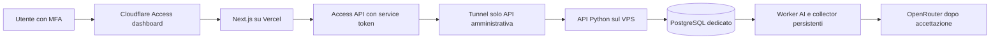

# Dashboard Vercel e backend persistente

Aggiornamento del 12 ottobre 2026. Preparazione prima della fase 6, autorizzata dal cliente. Il codice e i contratti sono collaudati localmente; DNS, account Vercel e Cloudflare, MFA reale e riavvio del VPS richiedono ancora accettazione nell’ambiente di destinazione. L’installazione esistente resta locale, paper, con OpenRouter e Telegram disattivati.

## Topologia e ambienti

La dashboard Next.js e le sue API di inoltro risiedono su Vercel. API Python, PostgreSQL, collector Telegram, worker AI, manutenzione e bridge isolato restano processi persistenti sul VPS Windows. Il backend è utilizzabile anche su Linux; MT5 resta un futuro componente Windows. Nessun worker continuo viene avviato da una richiesta Vercel.



| Ambiente | Dashboard | Backend e dati |
| --- | --- | --- |
| Sviluppo | pnpm dev, localhost | PostgreSQL locale, mock, integrazioni spente |
| Staging | Progetto Vercel dedicato e dominio stabile | Istanza PostgreSQL, porte, directory, utenti e credenziali indipendenti |
| Produzione | Secondo progetto Vercel e altro dominio | Seconda istanza PostgreSQL e credenziali indipendenti; paper fino ai gate successivi |

Usare **istanze PostgreSQL distinte**, anche sullo stesso VPS: i ruoli trd_api, trd_ai e gli altri sono identità di cluster. Due database nello stesso cluster con gli stessi ruoli non forniscono password indipendenti. Con Compose utilizzare nomi progetto, porte e volumi distinti; con Windows predisporre servizi/istanze PostgreSQL separati. Non copiare dati, password, sessioni Telegram o ricevute AI di produzione nelle preview. Per Telegram usare account diversi: lease in database separati non coordinano uno stesso account.

## Preparare i file privati

Dalla radice del repository:

```sh
pnpm env:new --stage staging --output-dir private/staging
pnpm env:new --stage production --output-dir private/production
```

Ogni comando crea operator.env con password e chiavi nuove, senza stamparle o sostituire file esistenti. Completare domini, issuer/audience Access, service token, email bootstrap e percorso RUNTIME_STATE_DIR sul server di destinazione. I modelli pubblici .env.staging.example e .env.production.example restano configurazioni incomplete: il backend rifiuta i placeholder del gate remoto. Per localhost continuare a usare pnpm setup e pnpm dev.

```sh
pnpm env:export --operator-env private/staging/operator.env --output-dir private/staging/scoped-v1
```

L’export convalida le impostazioni e crea .env.api, .env.ai, .env.telegram, .env.bridge, .env.maintenance e .env.dashboard. Ogni servizio riceve solo i campi del suo ruolo. Il comando rifiuta directory già esistenti: revisioni e rotazioni vengono preparate in una nuova directory, poi applicate con riavvio controllato. Proteggere i file con permessi 600 e directory 700 su Unix; su Windows applicare e verificare ACL per operatori e singolo account di servizio. I bit POSIX non certificano ACL Windows.

Solo .env.dashboard contiene la configurazione da trasferire nelle impostazioni server Vercel. Non caricare operator.env o .env del VPS su Vercel. Non usare NEXT_PUBLIC_ per credenziali o origini interne. La chiave OpenRouter appartiene solo al worker AI.

## Configurare Cloudflare

Creare due applicazioni Access per ambiente:

1. Applicazione umana sull’intero dominio dashboard, con utenti nominativi autorizzati, MFA IdP obbligatorio e durata massima del token di otto ore. Configurare un IdP OIDC/SAML che esporti il riferimento MFA; il backend richiede la lista amr, oppure custom.amr, contenente mfa. Verificare un token reale senza inserirlo in log, repository o documenti. Un semplice OTP email o un header dichiarato dal browser non soddisfa questo contratto. Altri formati MFA richiedono una modifica e un nuovo collaudo.
2. Applicazione API con policy **Service Auth** che accetti soltanto il service token della dashboard di quell’ambiente. Non aggiungere Bypass o Allow pubblico. Il token API è distinto dall’applicazione umana e dalla chiave DASHBOARD_PROXY_SECRET.

Configurare un tunnel nominativo che raggiunga soltanto l’API su loopback, con regola finale http_status:404. infra/cloudflare/tunnel.example.yml è un modello: adeguare UUID, percorso credenziale, dominio e porta. Non pubblicare PostgreSQL, Redis, RDP o il bridge tramite quel tunnel. Gestire cloudflared come servizio del sistema operativo e verificare riavvio senza login.

Il dominio dashboard deve passare da Access prima di raggiungere Vercel. Vercel sconsiglia proxy esterni per i normali siti pubblici: qui il proxy serve al controllo d’identità privato. Verificare DNS, certificati e cache nella topologia effettiva, usare TLS Full strict e non mettere in cache API o contenuti autenticati. L’URL diretto *.vercel.app può mostrare la shell, ma le richieste dati vengono rifiutate perché manca l’origine autorizzata o il token umano firmato. [Indicazioni Vercel sul proxy](https://vercel.com/kb/guide/cloudflare-with-vercel)

Il server Next inoltra il token umano come X-TRD-User-Assertion, separato dal token del servizio API. Il backend verifica RS256, chiavi dell’issuer fisso, audience dell’applicazione dashboard, date, email, soggetto e MFA. Verifica inoltre la chiave privata di inoltro e X-TRD-Environment prima di qualsiasi azione. Email e soggetto sono legati alla sessione applicativa; ruolo e password TRD rimangono verificati dal database. Non vengono creati automaticamente utenti SSO.

Fonti ufficiali: [verifica JWT Access](https://developers.cloudflare.com/cloudflare-one/access-controls/applications/http-apps/authorization-cookie/validating-json/), [claim personalizzati](https://developers.cloudflare.com/cloudflare-one/access-controls/applications/http-apps/authorization-cookie/application-token/), [MFA](https://developers.cloudflare.com/cloudflare-one/access-controls/policies/mfa-requirements/), [service token](https://developers.cloudflare.com/cloudflare-one/access-controls/service-credentials/service-tokens/).

## Configurare Vercel

Importare il monorepo in due progetti Vercel, staging e produzione. Selezionare framework Next.js, Root Directory apps/dashboard e includere i file fuori dalla directory principale: packages/shared-types e infra/scripts sono necessari alla build. Usare Node 24.x compatibile con il pin del repository e ENABLE_EXPERIMENTAL_COREPACK=1 nelle impostazioni di build; il packageManager della radice fissa pnpm 11.25.0. vercel.json usa corepack pnpm install --frozen-lockfile e pnpm build:vercel. Il build Vercel evita output standalone; quello locale lo conserva. [Monorepo Vercel](https://vercel.com/docs/monorepos/monorepo-faq)

| Variabile server dashboard | Valore da predisporre |
| --- | --- |
| API_INTERNAL_URL | Origine HTTPS dell’applicazione Access API, senza percorso |
| DASHBOARD_ACCESS_MODE | cloudflare |
| DASHBOARD_DEPLOYMENT_ENV | staging oppure production |
| DASHBOARD_ENVIRONMENT_ID | staging-paper oppure production-paper; uguale a ENVIRONMENT_ID del backend |
| DASHBOARD_PUBLIC_URL | Esatta origine HTTPS del dominio dashboard protetto |
| DASHBOARD_PROXY_SECRET | Chiave indipendente condivisa soltanto con l’API dello stesso ambiente |
| CF_ACCESS_CLIENT_ID e CF_ACCESS_CLIENT_SECRET | Service token dell’applicazione API dello stesso ambiente |

Impostare valori separati per Production e Preview nelle impostazioni Vercel. **Ogni preview deve usare staging**: il preflight blocca production nelle preview e blocca la modalità locale su Vercel. Anche l’API controlla l’ambiente prima delle scritture; il proxy verifica l’ambiente della risposta prima di consegnare dati.

Per una preview utilizzabile assegnare un alias/dominio stabile di staging protetto da Access e configurare esattamente quell’origine. Gli URL casuali delle singole preview non sono autorizzati; non aprire wildcard di origini. Aggiornare le variabili richiede un nuovo deployment. Il progetto staging può usare la propria distribuzione Production con DASHBOARD_DEPLOYMENT_ENV=staging. Nessuna variabile PostgreSQL, Telegram, MT5 o provider AI deve comparire nei progetti Vercel. [Ambienti Vercel](https://vercel.com/docs/environment-variables)

## Backend Windows e Linux

Windows nativo: creare istanze PostgreSQL e file di servizio distinti, applicare migrazioni e bootstrap con i comandi pnpm db:* e --operator-env. Generare il piano WinSW con New-NativeServiceTemplates.ps1 -BackendOnly -ServicePrefix trdstaging -ApiPort 8010 -BridgePort 8011 e directory private dedicate. -BackendOnly crea cinque servizi e non richiede il build dashboard o Node per la loro esecuzione. Fornire LayoutPath con il servizio PostgreSQL corretto di quell’istanza. La generazione -Write continua a richiedere l’artefatto WinSW verificato; non installa servizi. ACL, arresto ordinato e riavvio pre-login richiedono prove sul VPS. Non avviare una seconda dashboard sul VPS quando quella scelta è Vercel.

Linux/container: dopo aver completato operator.env e preparato data/ai per le ricevute private, utilizzare:

```sh
docker compose --env-file private/staging/operator.env -p trd_staging -f docker-compose.yml -f docker-compose.backend.yml up --build -d
```

L’overlay abilita esplicitamente i runtime staging/production, esclude dashboard e Redis dall’avvio ordinario e conserva porte host su loopback. Il worker vede data/ai in sola lettura come /var/trd/acceptance; configurare OPENROUTER_ACCEPTANCE_PATH=/var/trd/acceptance/nome-ricevuta.json solo dopo il collaudo. Eseguire i probe fuori dal contenitore con --receipt data/ai/nome-ricevuta.json, poi l’import con la credenziale operatore corretta. Staging e produzione devono utilizzare checkout/directory di stato e mount di accettazione indipendenti. Il healthcheck container remoto misura liveness; il collaudo autenticato deve verificare anche readiness e migrazione.

## Accettazione prima di aprire l’accesso

Verificare sul dominio reale: MFA obbligatorio, ADMIN e VIEWER, logout e scadenze, JWT assente/falso/scaduto, soggetto o email diversi, accesso diretto Vercel, service token errato, Origin/CSRF errati e ambiente errato. Provare una modifica di staging e confermare che i dati di produzione restano invariati. Verificare indisponibilità di API/database, rotazione delle chiavi Access, riavvio del tunnel/backend e protezione delle porte. Solo dopo queste prove consegnare il dominio remoto al cliente.

La fase 6, la riconciliazione e l’esecuzione MT5 restano da implementare. TRADING_MODE=paper, ENABLE_AUTOMATION=false ed ENABLE_LIVE_TRADING=false rimangono obbligatori.
