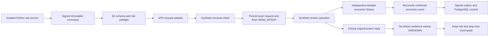

# MT5 order request adapter in local simulation

Revision: 12 October 2026, Europe/Rome. The MQL5 EA now translates approved opening,
stop-update and full-close commands into **MqlTradeRequest**. A synthetic terminal
port exercises broker checks, replies and independent durable history. Real terminal
account/market/history calls and native OrderCheck/OrderSend are excluded from the
compiled source. No external API, account credentials, native MT5 acceptance or broker
execution is claimed. The normal installation remains disabled; final external
tests and credentials remain the operator's responsibility.

## Execution and authority

`TrdBroker.mqh` owns the request builder and result classification;
`TrdBrokerSimulation.mqh` is the only terminal port;
`TrdLab.mqh` owns journal/outbox/recovery. The adapter introduces no public API,
database migration, process credential or dashboard toggle. API, collector, AI,
risk and maintenance credentials retain their separate authority. The EA has no
database or provider credential. Laboratory purpose keys are temporary, distinct
and generated locally without reading the operator's `.env`.

## Supported request profile

Only paper identity `TRD-PAPER-SIMULATOR`/login `1`, USD, hedging and exact symbol
`EURUSD.paper` pass. Metadata remains the reviewed spot-FX profile: five-decimal
point/tick, 0.01 minimum/step, one-lot ceiling, stops/freeze 10/5, mandatory attached
SL/TP and FOK full filling. Unsupported precision, symbol mappings, currency,
netting, filling or attached-stop behavior fail closed. No heuristic suffix mapping.
Quote age is independently bounded to two seconds; missing history/portfolio,
connection or permission closes the submission gate.

| Approved command | MqlTradeRequest |
| --- | --- |
| Market BUY/SELL | TRADE_ACTION_DEAL; exact volume; matching side; fresh ask/bid; attached SL/TP; FOK |
| Reducing protective update | TRADE_ACTION_SLTP; verified current position ticket; exact SL/TP; no deal volume |
| Full close | TRADE_ACTION_DEAL; verified current position ticket; opposite side; exact full volume; bid/ask; no opening stops |

Current ticket and lifetime position identifier are separate. Target checks include
opening command, managed ownership/magic, side, volume, exact entry value, prior
stops and revision. The builder accepts current tickets above JavaScript's safe
integer range without converting through float; the laboratory supports positive
signed-64-bit tickets only. A command comment is a bounded correlation hint, never
ownership or broker idempotency proof. Partial close and pending operations remain
unsupported. Native mixed-ownership/account verification remains a final gate.

Risk, prices and volumes use checked fixed-point integers. Only the final request
fields convert to native doubles. Volume is never rounded upward; deviation is
rounded downward to integer points and capped at the laboratory limit. The Python
approval/reservation remains mandatory and authoritative. After the synthetic
terminal check, expiry, ownership and the exact request are checked again before
intent. Changed economics are rejected without creating a send intent.

## Journal and results

The existing exclusively held account journal now records BROKER_GATE rejection
codes, BROKER_CHECK with the exact request, and BROKER_REPLY with API bool, original
retcode/retcode_external, request ID, order/deal tickets and returned volume/price.
Existing hash chaining, flushing, bounded capacity, key/profile/origin binding and
immutable command hashes remain in force. Replies count durable reply records,
not broker sends: a crash may leave economic history without a reply record.

| Evidence | Executor outcome |
| --- | --- |
| Failed independent checks or broker check before intent | REJECTED; gateway releases only unsent risk |
| Crash during preflight before intent | Reject abandoned command on recovery; no submission |
| PLACED or DONE reply without economic history | ACCEPTED then UNKNOWN; keep risk |
| Partial reply | Preserve original partial volume/code; UNKNOWN; full economic projection unavailable |
| Timeout, connection, false return, unknown code or rejection after intent | UNKNOWN; no automatic resubmission or risk release |
| Independent durable full fill, stop update or close | Reconcile original economic event once, even if the reply timed out |
| Crash after operation before reply | Reconcile durable history without sending again |

The partial scenario injects a partial **reply**; it does not implement partial
economic execution. Unknown results block further command polling and complete
account snapshots, preventing a fabricated empty/full portfolio. Outbox uploads
can continue. Native terminal transactions remain ignored by this simulation build
and cannot become authenticated laboratory evidence. Full broker-history and cash-flow
reconciliation, native transaction buffering and accepted manual resolution require
the later native port; there is no local shortcut that clears uncertain exposure.

## Repeatable tests

Run `pnpm mt5:accept`: disposable PostgreSQL 17 with independent roles, signed numeric
loopback HTTP, the actual EA source compiled with the portable C++ platform shim,
two openings, request checks, stop update, two full closes, duplicate suppression,
restart and paused close/resume. It removes its temporary database and keys.

`tests/unit/test_mt5_broker.py` exercises actual mapped native request fields,
BUY/SELL closes, current-ticket resolution, identity/capabilities, manual target
changes, preflight races, return codes and unknown-result restart. Integration
cases in `tests/integration/test_mt5_bridge.py` verify these results against real
role-scoped PostgreSQL and the gateway, including retained reservations and positions.
[Measured results](MT5_BROKER_VALIDATION.md).

For native synthetic testing use `pnpm mt5:lab --output-dir` and the existing
[terminal preparation procedure](MT5_LOCAL.md). Leave LocalCrashPoint and
LocalBrokerScenario empty for the ordinary cycle. Failure inputs affect only the
synthetic port and provide no native activation:

| Input | Scenarios |
| --- | --- |
| LocalCrashPoint | after_check, after_intent, after_result |
| LocalBrokerScenario preflight | check_false, check_rejected, disconnected, permissions, stale_quote, history_gap, foreign_position, changed_volume, quote_changed_after_check |
| LocalBrokerScenario replies | placed, done_without_evidence, partial, timeout, connection, send_false, send_rejected, external_error |
| LocalBrokerScenario history | placed_with_evidence, timeout_with_evidence |

## Final native and broker gates

MetaEditor compilation/warnings, terminal WebRequest, Windows scheduling, exclusive
locks/flush/disk failure, restart and reboot still need target evidence. A separate
native terminal port must be connected to the request core only under reviewed demo
identity, metadata/filling/stops, permission, all-account history/portfolio and
cash-flow acceptance. Native broker transaction buffering and recovery must preserve
the same conservative intent semantics. No config or dashboard change can make this
source call a broker. Broker credentials belong only in the terminal for the final
tests; HTTPS remote transport and live deployment authorization remain separate gates.

The request fields and conservative result interpretation follow the official
[MqlTradeRequest](https://www.mql5.com/en/docs/constants/structures/mqltraderequest),
[OrderSend](https://www.mql5.com/en/docs/trading/ordersend),
[return-code](https://www.mql5.com/en/docs/constants/errorswarnings/enum_trade_return_codes)
and [transaction-handler](https://www.mql5.com/en/docs/event_handlers/ontradetransaction)
contracts. These describe platform semantics, not acceptance of this broker/host.

12 October 2026 — Request mapping, synthetic terminal checks/replies and conservative
durable recovery added; native/external operation stays gated.
