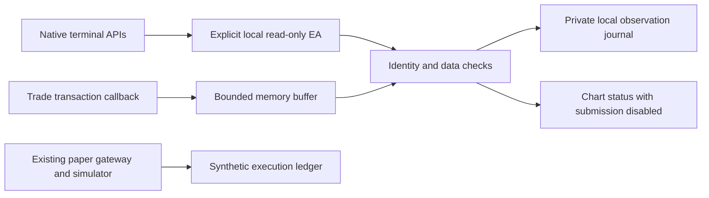

# Local native MT5 connection with submission disabled

Revision: 12 October 2026, Europe/Rome. A separate native MQL5 EA now reads account,
quotes, symbol metadata, all open positions, pending orders and selected deal/order
history. It buffers transaction notifications and writes private local observations.
**Broker submission is excluded from its source**: no OrderSend, OrderSendAsync,
trading library, OrderCheck or HTTP call. Credentials, actual MetaEditor/terminal,
Windows and demo acceptance remain the operator's final tests. Source tests use
native API fixtures without an account.

## Components and authority



`apps/mt5/Experts/TrdNativeReadOnly.mq5` owns the default-off lifecycle;
`apps/mt5/Include/TrdNative.mqh` owns native reads, current-ticket resolution,
buffering, journal and unconditional send refusal. It uses the existing crypto/JSON
core. Native data cannot authenticate as paper, become authoritative risk telemetry
or confirm executable fills. No migration, database/provider credential or dashboard
route is added; process permissions remain separate.

`TrdNativeSend` always returns false with a local disabled result, even with terminal
trading flags true. Open, protective-update and close requests are all blocked.
No input, account profile, mode or dashboard setting can enable submission. REAL
and CONTEST accounts are refused even for this reader; exact DEMO identity is required.

## Native observations and limits

Native calls use AccountInfo*, TerminalInfoInteger, SymbolInfo*, PositionGet*/Select,
OrderGet*/Select and HistorySelect/HistoryDealGet*/HistoryOrderGet*. Account names,
personal comments, credentials and source messages are not read or logged. Login,
server and trade observations remain private data; never commit or share journals.

| Data | Verified source behavior with fixtures |
| --- | --- |
| Identity | Exact positive login/server pin, DEMO mode; account switches latch a fault |
| Account | Currency, margin mode, balance, equity, free margin and observed permissions |
| Market | Exact symbol, native tick milliseconds, bid/ask, point/tick size, volume bounds, contract, stop/freeze levels, filling/trade/calculation flags and currencies |
| Portfolio | All positions and pending orders, including manual/unprotected and foreign trades; magic never proves ownership |
| History | Raw deal/order types, price/volume, profit, commission, swap, fee and cash-flow observations in an explicit broker-time window |
| Target | Fresh lifetime-identifier lookup resolves the current ticket; no float conversion or ownership grant |
| Transactions | Callback copies bounded memory only; scans and disk work occur on timer |

Finite native doubles serialize as decimal strings with sixteen fractional digits;
they do not replace the Decimal/fixed-point risk engine. Negative equity/free margin
and signed fees remain visible. Netting is observable, not accepted for execution.
Missing fields, nonfinite values, unsupported/non-ASCII metadata, duplicate tickets,
oversized scans or a changed portfolio prevent publication. Tickets support the
positive signed-64-bit range; larger unsigned values fail closed.

UTC observation time comes from TimeGMT. Tick/history timestamps and selection
windows stay on the **broker-time** axis; no UTC offset is guessed. Market-watch time
must be within thirty seconds of the estimated native server clock and the selected
tick within ten. Scans are bounded to two seconds and reread portfolio/identity.
This detects common races, not an atomic remote snapshot.

`history_window_observed=true` means a selected window was read;
`full_reconciliation=false` remains explicit. A limited window cannot prove absence
of older deals, ownership, a UTC daily-loss baseline or complete recovery. Cash flows
and hints never create financial projections; duplicate/reordered hints produce no
extra deals. For REQUEST notifications only trans.type and result fields are used;
undefined fields are discarded. For other types, request/result data is ignored.
Overflow latches a fault; callbacks do not send, read account/history, write files or
perform network work. A crash can lose unrecorded hints; later reconciliation must
inspect broker history rather than assume callback completeness.

## Preparing the operator's final test

```text
pnpm mt5:native:prepare --output-dir <new-private-directory>
```

This creates only native EA/core sources, a journal identity preset in the copied
source and an Italian LEGGIMI. It reads no `.env`, starts no terminal/service and
contains no credentials. Existing directories are refused; the copy stays disabled.

1. At final testing, log into the authorized DEMO account in MT5 itself. No password
   or broker API credential belongs in this project, dashboard or chat.
2. Copy TRD into MQL5/Experts, retain sibling Includes and compile
   `TRD/Experts/TrdNativeReadOnly.mq5` with MetaEditor; inspect errors/warnings.
   No `.ex5` or native compilation is delivered here.
3. Pin NativeExpectedLogin, NativeExpectedServer and NativeSymbol exactly. The symbol
   must already be in Market Watch; no mapping, SymbolSelect or broker login is performed.
4. Keep NativeJournal unchanged across restarts. Attach one chart and explicitly set
   ActivateNativeReadOnly=true. Default is false; missing inputs and Strategy Tester
   are refused. No WebRequest origin, bridge key or database setting is required.
5. NativeHistorySeconds defaults to 3600 and permits 60–86400 seconds. Inspect the
   Italian chart status and private journal. Do not add or activate an order sender.
6. Stop before changing journal/profile/window or archiving diagnostics. Restrict
   source and Common/Files to the operator with POSIX permissions or Windows ACLs;
   keep account credentials only in MT5.

The FILE_COMMON journal resides at `TRD-NATIVE/<account-hash>/observations.log`.
Exclusive opening prevents two charts/terminals owning the same account journal.
Binding covers account, symbol, window and journal identity. Hash chaining, a monotonic
sequence, checked writes and flush precede clearing hints. Restart restores sequence,
never stale snapshot freshness. Corruption/flush failure latches a fault; contact loss
clears the observation and can recover.

Limits: 64 positions, 64 pending orders, 128 selected deals, 128 history orders,
128 queued hints, approximately 64 KiB per record, 10000 observations and 8 MiB per
journal. Exceeding a limit stops publication without truncation. Stop and archive
private files before an explicit new session; no automatic pruning is added. Native
flush/locks, power loss and throughput still require Windows acceptance.

## Source acceptance and remaining gates

`pnpm mt5:native:accept` requires pinned dependencies and a local C++17 compiler.
It includes the actual native EA/module with fixtures for native primitives; Python
does not reimplement observation, journal or send-gate logic. The cycle tests all
reads, buffering, current-ticket resolution, send refusal with permissions on and
restart; temporary files are removed. `pnpm mt5:accept` independently verifies the
signed paper cycle. [Measured evidence](MT5_NATIVE_VALIDATION.md).

Actual MetaEditor types/runtime, terminal/broker API results, timezone/history quality,
Windows file behavior and restart/reboot remain final acceptance. Native order
preflight and signed authoritative demo telemetry are not enabled by this connection.
A future sending build needs independent demo acceptance, risk authority and deployment
gates; the dashboard cannot supply them.

Platform contracts: [account properties](https://www.mql5.com/en/docs/account/accountinfodouble),
[position reads](https://www.mql5.com/en/docs/trading/positiongetticket),
[tick structure](https://www.mql5.com/en/docs/constants/structures/mqltick),
[history in server time](https://www.mql5.com/en/docs/trading/historyselect), and
[transaction structure](https://www.mql5.com/en/docs/constants/structures/mqltradetransaction).

12 October 2026 — Native observation source, journal, transaction buffer and unconditional
send block implemented; external credentials and demo acceptance deferred.
