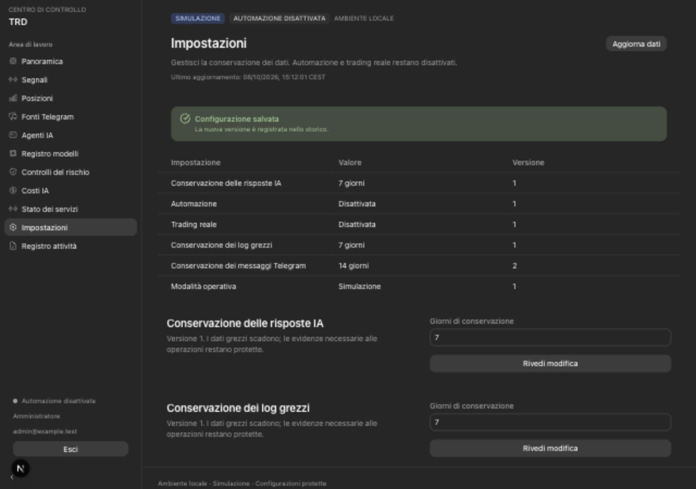

# Phase 3 validation — authenticated Italian dashboard

Date: 2026-10-08. Scope: local paper deployment only.

## Delivered

- ADMIN/VIEWER login, logout, hashed opaque sessions, idle/absolute expiry,
  active-user checks, shared login throttling, CSRF and Origin enforcement.
- Astryx navigation and real database pages for overview, positions, signals/detail,
  sources, agents, model registry, risk, costs, settings, audit and process status.
- Confirmed, versioned retention/risk/disabled-agent edits, with atomic audit,
  concurrency checks and replay/session/payload/expiry protection.
- Explicit operator user creation and bounded maintenance-only authentication cleanup.
- Frozen forward/backward migration, ORM parity and generated OpenAPI/client types.

The [authentication contract](DASHBOARD_AUTH.md) records the authority boundaries,
server policy and remaining external-access requirements.

## Evidence

The final suite contains **179 Python tests** (121 unit and 58 real PostgreSQL 17
integration tests), plus **11 frontend tests**, for **190 passing tests**. PostgreSQL
tests use newly created random `trd_test_*` databases; the primary volume is preserved.
Ruff, strict TypeScript, ESLint and the production Webpack build pass.

The Phase 3 integration coverage checks wrong/unknown credentials, cookie flags,
validation redaction and body bounds; reader and inactive-user rejection; idle,
absolute and revoked sessions; confirmation substitution, replay, expiry, cross-session
use and version conflicts; bounded risk and disabled-agent publication; domain-equivalent
risk fingerprints; active-exposure rejection without partial writes; concurrent shared
throttle reservations and bounded password-verification concurrency; maintenance cleanup; operational paging/environment scope;
and continuing denial of direct credential-table and trade-authority access.
Earlier migration, locking, lifecycle, evidence-retention and least-privilege tests
also pass against the new head. A downgrade to the foundation and re-upgrade preserves
the existing administrator password.

Browser verification used a separate disposable PostgreSQL database and local test
accounts. Confirmed: administrator login; all navigation entries; six disabled agents
and configuration fields; current risk limits; a Telegram-retention edit from seven
to fourteen days through the confirmation dialog; persisted version two and the
administrator's audit entry; logout; viewer login with zero editable fields and no
save controls; stale-data notice; and mobile drawer navigation. Desktop 1280×900
and mobile 390×844 layouts were inspected; the mobile page width remains 390 pixels.
The sample edit and accounts were confined to this disposable database.

The existing local Compose deployment is rebuilt and upgraded in place. Smoke checks
confirm schema `0003_dashboard`, ready API, authenticated page protection, successful
bootstrap-admin login through the same-origin Next proxy, real operational reads,
logout revocation, and paper mode with automation/live trading false. No test
configuration changes are applied to the primary database.

## Limits

This is Phase 3 acceptance for the local dashboard, not production or trading
acceptance. External production MFA/Access verification is still unavailable and
remote production origins are rejected. The current proxy applies peer throttles to
its shared hop. Model manifest editing and prompts remain operator-owned. Agents,
Telegram ingestion, provider requests, the risk gateway and MT5 execution are inactive.
Risk edits with existing exposure are refused. Authentication cleanup runs explicitly;
its periodic scheduling is not configured. Raw-log age pruning is not implemented;
the stored period is preparation and size/count rotation remains active. Windows-native, EA and demo-broker gates
remain unchanged. Phase 4 is Telegram ingestion and durable message/version capture.
