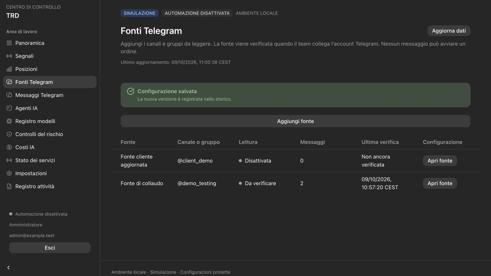
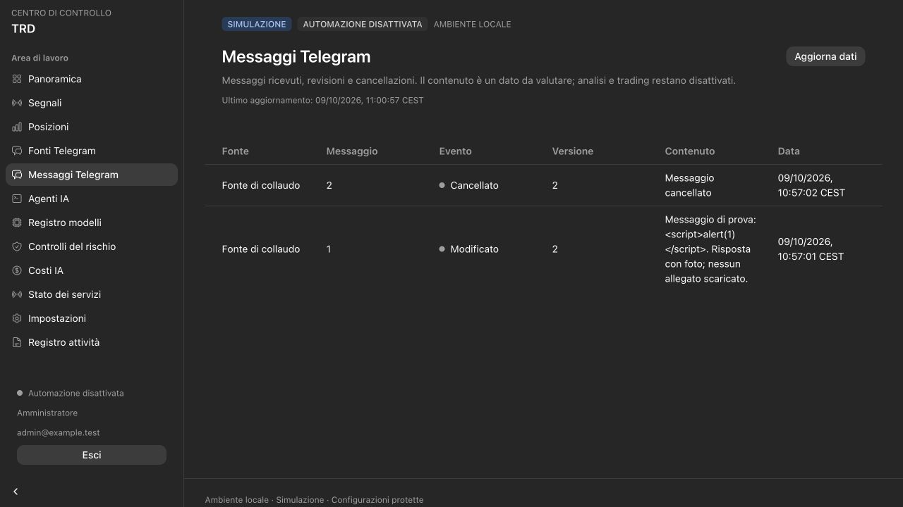

# Phase 4 validation — Telegram collection and client-managed sources

Date: 2026-10-09. Acceptance scope: local paper installation, synthetic Telegram
observations and disposable PostgreSQL databases. Real Telegram enrollment is deferred
at the user's request; the client will choose sources through the dashboard.

## Delivered

- Operator-only interactive enrollment/replacement/key rotation and an authenticated
  encrypted StringSession, including durable connection-state updates.
- A read-only Telethon adapter with bounded history/overlap/known-ID reconciliation,
  text/caption/reply/media metadata and durable NEW/EDIT/DELETE evidence.
- PostgreSQL account lease generations, source-version fencing, durable flood-wait
  deadlines, cursor isolation, atomic audit/outbox/future analysis handoffs and
  conservative invalidation of unsent work.
- Confirmed ADMIN source creation, public-link normalization, rename and disable;
  VIEWER consultation; Italian source status and latest-message preview pages.
- Frozen migration `0004_telegram`, forward/backward compatibility, 39-table ORM parity,
  least-privilege grants and reproducible generated API types.
- Two maintained Italian Word guides: three pages for customers and six for the team.
  Their Markdown sources, regeneration script and root AGENTS update requirement
  make documentation part of subsequent feature work.

## Automatic evidence

The suite contains **207 Python tests**: 140 unit and 67 PostgreSQL 17 integration
tests. The complete run passes; the final encrypted connection-state persistence
change also passes all 19 Telegram unit tests. **11 frontend tests** pass, for
**218 tests** across the project. Ruff, strict TypeScript, ESLint and the production
Webpack build pass. API generation produces identical files on a second run.

New coverage includes encryption scope/account/key/key-ID binding, tamper and file
permission rejection, random nonces and atomic-write failure; strict source references
and message normalization; memory-only transport sessions; encrypted DC-state persistence;
mocked offline edits/deletions and bounded old-cursor recovery; lease loss before network
work and degraded status after a mid-cycle failure. PostgreSQL checks contention,
expiry/generation fencing, duplicate/edit/delete/reply history and no resurrection,
transaction rollback, old-message rejection for fresh analysis, overlap cursor isolation,
source changes during collection, persisted flood waits, denied direct inserts/foreign
service claims, confirmed source revisions/audit/redacted projections and invalidation
of unsent work while retaining reservation evidence. Earlier authentication, risk,
migration, lifecycle and retention checks continue to pass.

All integration databases use randomly generated `trd_test_*` names; they are dropped
by their fixtures. Primary application data/volumes are preserved. The locked runtime
Python dependency graph was exported and checked with pip-audit on this date: no known
vulnerabilities were reported. This is an advisory snapshot, not a future guarantee.

## Browser and document evidence

The browser fixture used a separate disposable database, synthetic ADMIN/VIEWER users
and fabricated source/message content. Confirmed: public-link source creation through
review/save; canonical saved reference; pending connection state; name/disable version
two; fixed source reference; matching audit entries; latest edited/deleted messages;
literal script-like text with zero script nodes/dialogs; stale observation warning;
VIEWER source fields without add/review/save controls; Italian read-only accessibility
label; mobile drawer, source form and message table at 390×844. Page width remains
390 pixels; tables scroll within their container. Desktop inspection used 1280×720.
No test source/configuration was written to the primary database.

Both Word documents were generated from their maintained Markdown, rendered through
the Documents skill's bundled LibreOffice/Poppler pipeline, and every rendered page
was visually inspected. Titles, repeated table headers, pagination, commands and
long environment-variable names remain readable without clipping. QA intermediates
are excluded from the repository and delivery.

## Local deployment evidence

Backend and standalone dashboard images were rebuilt from the locked graph and the
existing Compose installation upgraded in place. Initialization completes; API,
dashboard, bridge and PostgreSQL health checks pass, and worker/collector/maintenance
processes remain running. Authenticated same-origin smoke verifies protected pages,
login/read/logout revocation, sources/messages endpoints and schema `0004_telegram`.
Six agents remain disabled, providers mock, trading paper, automation/live false,
Telegram false, and the primary message/command tables remain empty. Enrollment and
source selection are not required to install this release. The primary login page
was inspected in the browser after deployment.

## Remaining gates

The team must enroll the authorized human account and test actual Telegram source
access, network reconnect, edits/deletions, flood waits and long interruption behavior.
No account, phone, verification code, real source message or application API credential
was used in this turn. Missed/deleted events and revisions beyond the bounded window
cannot be guaranteed recoverable; persistent gaps require operator assessment.

Analysis handoff jobs are storage preparation only. Parsing, provider adapters,
deterministic risk/execution, broker reconciliation and MT5 remain later phases. Native
Windows ACL/session/service recovery, EA compilation, demo-broker tests and external
MFA/Access verification remain target-environment gates. Live trading and external
production access have not been enabled. See [the Telegram contract](TELEGRAM.md),
[customer guide](cliente/GUIDA_CLIENTE.md) and [team guide](team/GUIDA_PREPARAZIONE.md).
