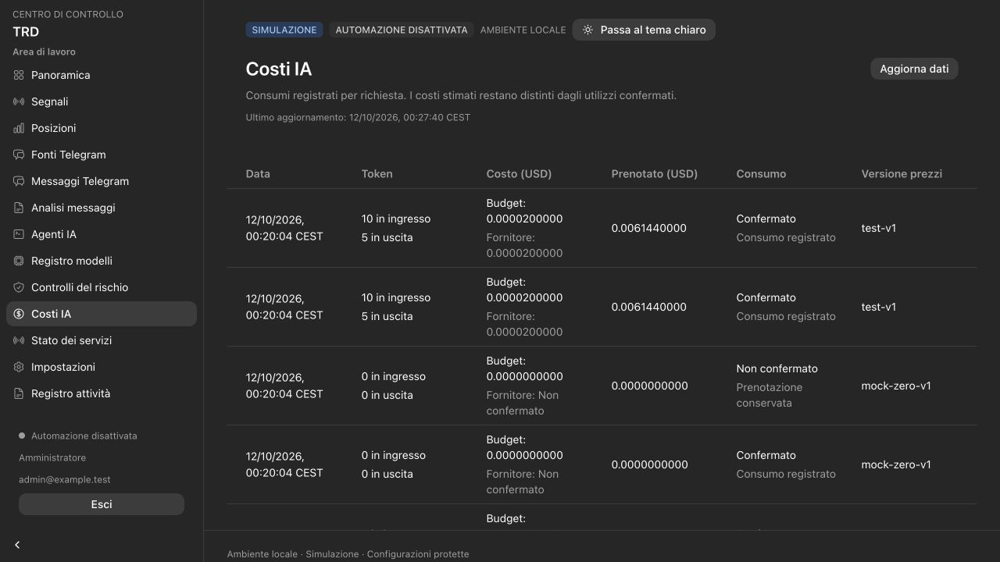

# Phase 5b validation — Vercel, remote access and OpenRouter

Date: 2026-10-12, Europe/Rome. Scope: the preparation requested before Phase 6.
The modular Python backend remains persistent on Windows, with a Linux/container
deployment path. Financial risk authorization, execution and MT5 are not implemented
by this change. No public deployment, real account enrollment or paid AI request was
performed during validation.

## Delivered

- Next.js Vercel configuration and a build preflight requiring a protected HTTPS
  origin, matching backend environment and private server credentials. Preview
  deployments cannot target production. The local standalone build remains available.
- Same-origin dashboard transport with a fixed route allowlist. The server sends
  separate Cloudflare service credentials, the original human assertion, the private
  proxy key and an environment identifier. It validates the response environment.
- API verification of RS256 Access JWTs, a fixed issuer/audience, bounded JWKS,
  expiry, identity and an explicit MFA claim. Remote sessions bind both the email
  and the issuer/subject identity to the existing password, roles, CSRF and confirmed
  configuration flow. Service credentials alone do not establish human identity.
- Independent staging/production templates and private environment generation/export.
  Runtime files retain separate database roles; Vercel receives only dashboard
  transport configuration. PostgreSQL instances, ports, state and account credentials
  must remain independent across environments.
- Backend-only Windows service previews with separate service prefixes and listener
  ports. The Linux Compose overlay excludes dashboard/Redis from ordinary startup,
  explicitly enables deployment runtimes and mounts AI acceptance material read-only.
- A pinned OpenRouter adapter, an explicit synthetic paid acceptance command and
  immutable model import. Receipts bind environment, model/provider, reviewed prices,
  API-key fingerprint and a maximum seven-day validity. Import does not activate agents.
- Model selection for the three advisory stages after acceptance, with a confirmed
  positive request ceiling. Classification and parsing remain local. Conservative
  cost reservation, separate provider-reported cost and unknown-usage holds preserve
  the existing spend gates. AI output never authorizes a financial order.
- Forward migration `0005b_remote_openrouter` with the existing 41 application tables,
  runtime-role isolation and metadata parity. Downgrade refuses to erase imported
  OpenRouter history; a rollback with such history requires operator review.

## Automatic evidence

| Check | Result |
| --- | --- |
| Python unit tests | 252 passed |
| PostgreSQL 17 integration tests | 101 passed, complete suite |
| Dashboard tests | 16 passed |
| Distinct passing test cases | **369** |
| Ruff, strict TypeScript, ESLint | Passed |
| Local and Vercel production builds | Passed |
| Backend and standalone dashboard container builds | Passed |
| Regenerated OpenAPI and shared TypeScript types | Byte-identical; no contract drift |
| Windows scripts: parsing, configuration and read-only previews | Passed with PowerShell 7.6.6 on macOS |
| Staging and production Compose overlays | Seven default backend services; local-only listeners and credential scopes verified |

Remote-access coverage includes missing/forged/expired tokens, algorithm/key/issuer/
audience restrictions, MFA and identity mismatch, key refresh, protected mutations,
session identity binding and environment fencing. Dashboard tests verify direct
origin refusal, preview/production separation, header ownership and response fencing.

OpenRouter tests use a fake HTTP transport and synthetic proposals. They cover exact
Decimal prices and cost, reviewed catalog limits, mandatory structured output,
one-provider routing, provenance, expiry, refusal/incomplete output, quota/rate limits,
unknown usage, reported cost beyond estimates, receipt/key/environment binding and
non-overwriting receipt/import behavior. Real billing and model quality are not
inferred from these fixtures.

Integration and browser fixtures use randomly named `trd_test_*` databases. The
browser fixture was stopped and its isolated database removed after inspection.
The primary database and volumes were preserved.

## Browser and document evidence

The browser fixture verifies the approved OpenRouter provider and expiry in the model
selector; editable request cost and its exact before/after confirmation; separate
accounted and provider-reported costs; and retained unknown-consumption reservations.
The cost change was reviewed and cancelled. No agent or source was activated in the
primary installation.

Desktop inspection used the default 1280×720 viewport. At 390×844 the navigation
drawer, horizontally contained tables and agent form remain usable; both cost and
agent pages retain a 390-pixel document width. The form, Italian copy and date/time
display were visually checked. The final browser console has no errors.

Both maintained Italian Markdown guides have the 12 October revision and history
entry. The matching Word files were regenerated with the Documents skill's bundled
runtime and rendered through its LibreOffice/Poppler workflow. Every rendered page
was visually inspected: five customer-guide pages and ten team-guide pages. Table
headers, variable names, commands, pagination and margins remain readable. Intermediate
PDF/PNG files stay outside the delivered documents and Git.

## Local deployment evidence

The existing Compose installation was rebuilt and upgraded in place. Initialization
completed at `0005b_remote_openrouter`. PostgreSQL, API, dashboard and bridge health
checks pass. API, AI, risk and maintenance publish fresh HEALTHY heartbeats; the
collector publishes STOPPED because collection is disabled.

Authenticated same-origin login, protected operational reads, page responses,
`no-store`, status/readiness and logout/session revocation pass. The installation
retains 41 application tables, zero enabled agent configurations and no source,
message, signal, analysis, budget reservation or execution command. No OpenRouter
model was imported into the primary database. Local private credentials were not
changed. Remote access remains local, provider mode remains mock, Telegram is off
and all trading flags remain paper/disabled.

## Remaining acceptance

Real Vercel/Cloudflare accounts, protected domains, DNS/TLS, service tokens and an IdP
exporting the required signed MFA claim must be configured and tested. Verify ADMIN/
VIEWER, expiry/logout, direct Vercel access refusal, CSRF/origin failures, actual
staging/production separation and tunnel/backend restart before delivering access.

Native Windows service registration, effective ACLs, PostgreSQL instances, shutdown,
backup/restore and recovery before interactive login still require tests on the VPS.
The PowerShell preview does not certify those operating-system behaviors. The new
Windows and Vercel checks are included in CI; no remote CI run is claimed here.

OpenRouter needs a dedicated key/account, current exact endpoint capabilities/prices,
credit and account spend limits; an explicit paid synthetic probe/import; routing/
privacy, real usage/cost and timeout/quota acceptance; and quality checks on approved
fixtures. Unknown charges remain held. An operational reconciliation procedure is
still required before using paid agents with real data; automatic release is not
implemented. Telegram enrollment remains an explicit local operator action.

Phase 6 and subsequent risk, reconciliation, broker/demo, MT5 and live-trading gates
remain future work. See [deployment](DEPLOYMENT_VERCEL.md), [OpenRouter](OPENROUTER.md)
and the maintained [team guide](team/GUIDA_PREPARAZIONE.md).
