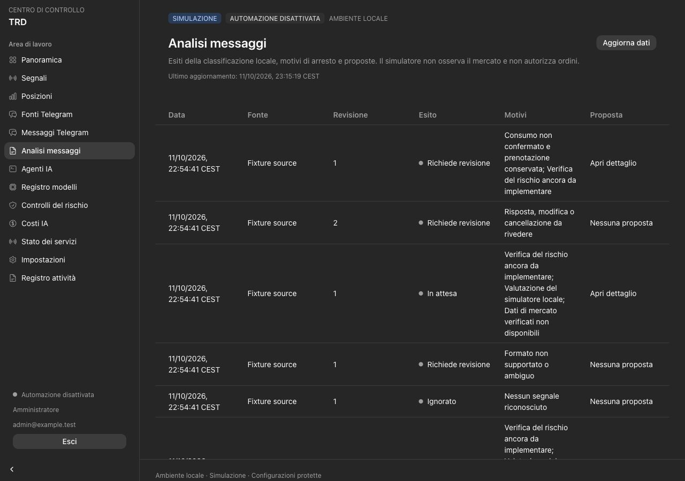

# Phase 5 validation — local advisory analysis

Date: 2026-10-11, Europe/Rome. Acceptance scope: paper analysis with synthetic
observations, PostgreSQL 17 and an offline provider. External AI network access,
financial risk authorization and MT5 remain separate acceptance gates.

## Delivered

- Strict local classification and parsing of one complete Forex proposal, with
  Decimal prices, publication-time expiry and no inference from ambiguous text.
- Durable AI job consumption with job owner/generation, source/message revision
  and configuration fencing. Receipt, optional proposal, legal lifecycle changes,
  metadata-only audit/outbox and job completion commit atomically.
- Required classifier/parser configurations and advisory market/decision stages;
  an enabled or required critic runs without weakening the mandatory route.
  POSITION_REVIEW_AGENT and adaptive memory remain unavailable.
- Versioned prompts, schema/model checks, one bounded deadline and up to three
  attempts per agent. A PROPOSE result still cannot grant financial authority.
- Serialized worst-case spend reservations and usage accounting, including
  unresolved requests across restarts and UTC period rollover. No automatic
  release or blind resubmission of unknown usage.
- Italian analysis outcomes, reasons, proposal links, agent-attempt detail and
  consumption/reservation visibility. ADMIN activation uses the existing confirmed
  configuration flow; installation leaves all agents disabled.
- Frozen migration `0005_analysis`, 41-table ORM parity and separate runtime roles.
  The Responses wire adapter accepts only a fake transport and has no live runtime
  activation path or API-key requirement for the local simulator.

## Automatic evidence

The current suite contains **277 Python tests**: **181 unit** and **96 PostgreSQL
integration** tests. The complete database run passed all 90 tests present before
the last six cases were added. The final phase-5 run passes all 29 analysis tests,
including those six cases; the 67 existing database tests retain their passing
evidence. **11 frontend tests** pass, giving **288 distinct passing tests**.
Ruff, strict TypeScript, ESLint, the production Webpack build and both container
images pass. Regenerating API types produces byte-identical files.

Coverage includes exact grammar, injection/extra instructions, unsupported symbols,
inconsistent protective prices, replies/edits/deletions and independent freshness;
atomic rollback/idempotency, immutable proposal hashes, source/config/lease changes,
restart with unresolved reservations and denied foreign-role writes. Spend tests
exercise concurrent reservations, each independent budget cap and unknown usage
from an earlier accounting period. Fallback tests verify recovery, exhaustion,
Retry-After, quota and unknown-consumption stops. A valid PROPOSE remains WAITING
without an execution command. Required/optional critic behavior is verified.

Offline Responses tests cover a fixed origin, strict schema, `store=false`, no tools,
redirect refusal, deadline, refusal/incomplete/errors, duplicate JSON keys and
bounded, valid usage without double-counting reasoning/cached token subsets.
No real model access, price, billing accuracy or decision quality is claimed.

All integration and browser fixtures use random `trd_test_*` databases and synthetic
messages. Their cleanup removes only those test databases. The primary application
database and volumes are preserved.

## Browser and document evidence

The separate browser fixture verifies WAITING, escalation, ignored noise and edited
message review; proposal prices and recorded agent attempts; confirmed critic
activation with prompt version 1 → 2; saved configuration version 2; and retained
unknown-consumption reservations. Position review remains read-only in the form
and rejected by the API when activation is attempted. Existing API tests verify
VIEWER restrictions and confirmation/session/version binding.

Desktop inspection uses 1280×900. At 390×844 the drawer opens correctly, the
analysis table scrolls horizontally inside its container and the agent form keeps
the page width at 390 pixels. Italian copy, date/time display and stale-data
feedback were checked; the final browser session reports no console errors.
No test activation or source is saved to the primary database.

Both maintained Italian guides have an 11 October revision/history entry and were
regenerated with the Documents skill's bundled Python and LibreOffice/Poppler
pipeline. Every page was visually inspected: four customer-guide pages and seven
team-guide pages. Tables, repeated headers, long variable names, pagination and
commands remain readable. Intermediate PDF/PNG files stay outside delivery and Git.

## Local deployment evidence

The existing Compose installation was upgraded in place with rebuilt backend and
standalone dashboard images. Initialization completes at `0005_analysis`; API,
dashboard, bridge and PostgreSQL health checks pass. AI/API/risk/maintenance
heartbeats are fresh and HEALTHY. The collector process runs and reports STOPPED
because `TELEGRAM_ENABLED=false`, as intended.

Authenticated same-origin login/read/logout verifies protected analysis, agent,
signal and cost pages, operational API responses, `no-store` and session revocation.
The primary database contains 41 application tables, five added prompt versions,
six disabled agents and no source, message, signal, analysis, spend reservation or
execution command. Provider mode is mock, all four spend envelopes are zero,
proposal freshness is 900 seconds and the job lease is 180 seconds. Trading remains
paper; automation/live and Telegram collection remain disabled.

## Remaining gates

Real Telegram still requires explicit operator enrollment and authorized-source
network acceptance. Live AI transport requires actual account/model access,
verified capabilities/prices, defensible input-token and charge ceilings, real
timeout/billing tests and quality evaluation on approved fixtures. Unknown spend
requires a reconciliation procedure before any paid activation. The AI process is
trusted to enforce its deployed spend arguments; this is not isolation from hostile
code holding its credentials.

Deterministic financial risk, market/account freshness, execution authorization,
broker reconciliation, MT5/EA compilation and demo-broker acceptance remain later
work. Native Windows recovery/ACLs and external MFA/Access acceptance are not covered
by local tests. No Telegram enrollment, real source message, external AI request or
broker action was performed. See [the analysis contract](ANALYSIS.md),
[customer guide](cliente/GUIDA_CLIENTE.md) and [team guide](team/GUIDA_PREPARAZIONE.md).
