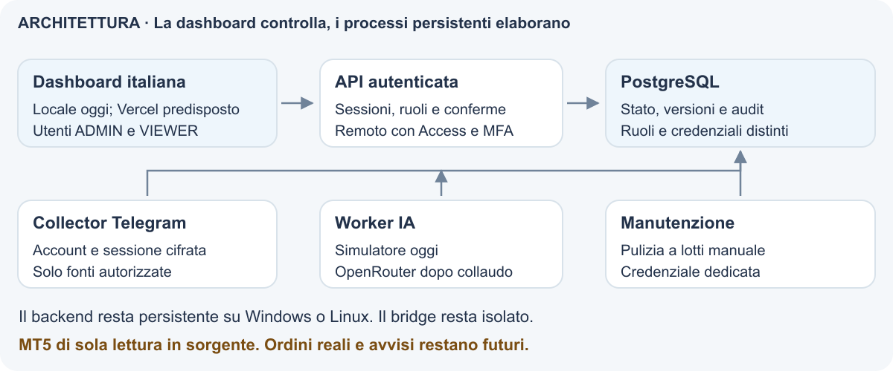
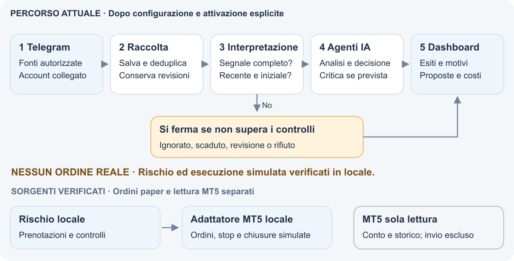

# TRD Guida di preparazione

Aggiornamento del 12 ottobre 2026 | Fase 7 | Checklist operativa del team

Dashboard, Telegram, analisi e rischio sono implementati e verificati con dati di prova. **L’installazione resta locale, con Telegram e agenti disattivati.** Il laboratorio paper verifica dati firmati, ordini, stop, chiusure e ripresa. API e credenziali esterne saranno preparate per i test finali; account, accesso remoto, server reale e MT5 richiedono collaudo.

Questa guida raccoglie le azioni di preparazione; i contratti completi restano nei documenti tecnici collegati. Nessun esempio contiene credenziali o messaggi personali.

## Componenti e responsabilità



| Account o componente | Da predisporre |
| --- | --- |
| Utenti TRD e PostgreSQL | Utenti nominativi ADMIN e VIEWER; credenziali distinte per migrazione, API, collector, AI, rischio e manutenzione |
| Telegram | Account umano autorizzato, accesso alle fonti, API ID e API hash; enrollment locale esplicito |
| Vercel e Cloudflare | Due progetti, domini stabili, IdP con MFA e claim firmato, tunnel API e service token distinti |
| OpenRouter | Account e chiave per ambiente, credito, prezzi, provider e limiti verificati |
| Server e backup | Windows persistente o backend Linux, stato privato, backup cifrati e prova di ripristino |
| MT5 | Bridge paper e lettore nativo in sorgente; compilazione, terminale e demo da collaudare. Invio escluso |
| Bot avvisi | Futuro e separato dalla lettura Telegram |

Staging e produzione usano **istanze PostgreSQL, porte, volumi, directory, chiavi e account indipendenti**. Database diversi nello stesso cluster non permettono password diverse per gli stessi ruoli. Account Telegram distinti evitano collector non coordinati fra ambienti.

## Avvio locale

1. Usa i lockfile: Node 24.20.0, pnpm 11.25.0, Python 3.13.16, uv 0.12.22, PostgreSQL 17 e Docker Compose. Redis è facoltativo.
2. Esegui `pnpm setup`, poi `docker compose up --build -d`. Il setup genera segreti distinti e conserva `.env` esistente; aggiungi manualmente nuovi campi se necessari. Non eliminare volumi per aggiornare.
3. Verifica migrazione `0008_paper_positions`, salute servizi e ruoli separati. Crea utenti nominativi con `pnpm user:create` da terminale interattivo.
4. Apri `http://localhost:3000`; prova ADMIN, VIEWER, uscita e conferme. Agenti e raccolta non si attivano automaticamente.

| Configurazione iniziale | Vincolo |
| --- | --- |
| TRADING_MODE | `paper`; demo e live ancora rifiutati |
| ENABLE_AUTOMATION e ENABLE_LIVE_TRADING | `false`; non modificarli per provare Telegram o IA |
| AI_PROVIDER_MODE e budget AI_HARD_* | `mock` e budget `0.00` per il simulatore gratuito |
| TELEGRAM_ENABLED e ENABLE_ADAPTIVE_MEMORY | `false`; memoria adattiva non implementata |
| APP_ENV e ENVIRONMENT_ID | Coerenti fra processi; development/local-paper in locale |
| APP_URL e AUTH_COOKIE_SECURE | Origine esatta; cookie sicuro obbligatorio su HTTPS |

Non passare `.env` operatore intero ai servizi. Ogni processo riceve solo campi e credenziali propri; il migratore non è un ruolo runtime. URL PostgreSQL con `postgresql+psycopg`, porta e ruolo previsti. In remoto, stato e log in directory assolute e private. Inventario e vincoli in [Configurazione ambiente](../ENVIRONMENT.md) e `.env.example`.

Tema chiaro e scuro verificato in locale e su mobile, senza nuove credenziali. Il cookie `trd-dashboard-theme` vale un anno, appartiene al browser e all’host; il server applica il tema al primo rendering. Sessioni: 30 minuti inattive e 8 ore assolute. Conferme: 2 minuti, legate a utente, contenuto e versione.

## Collegare Telegram

1. Ottieni API ID e API hash dall’applicazione su `https://my.telegram.org`. Configura `TELEGRAM_API_ID`, `TELEGRAM_API_HASH` e la chiave indipendente `TELEGRAM_SESSION_ENCRYPTION_KEY` nel file privato del collector.
2. Ferma il collector. Per sviluppo host usa `pnpm telegram:enroll`; per Compose usa i comandi sotto da terminale interattivo.
3. Inserisci telefono, codice e password a due passaggi solo nella procedura locale, mai nella dashboard, nei log o negli artifact.
4. Dopo l’accesso riuscito imposta `TELEGRAM_ENABLED=true` e ricrea il servizio. Il cliente autorizza le fonti dalla dashboard; l’account deve già accedere ai gruppi privati.

```sh
docker compose stop telegram
docker compose run --rm --no-deps --entrypoint python telegram -m backend.integrations.telegram.enroll
```

Dopo la modifica del file privato:

```sh
docker compose up -d telegram
```

La sessione è cifrata AES GCM e legata ad ambiente, account, collector e chiave. Il volume resta scrivibile e privato: permessi 600 su macOS/Linux, ACL verificate su Windows. Non copiare sessioni host nel volume senza gestire proprietario e permessi. Conserva la chiave separata dal backup della sessione.

| Parametro | Default e limite operativo |
| --- | --- |
| TELEGRAM_POLL_SECONDS | 30 secondi; non promette latenza costante |
| TELEGRAM_BACKFILL_MAX_AGE_SECONDS | 86400 secondi; recupero limitato a 24 ore |
| TELEGRAM_HISTORY_BATCH_SIZE | 100 messaggi per richiesta |
| TELEGRAM_SIGNAL_MAX_AGE_SECONDS | 900 secondi; filtro di analisi, non autorizzazione al trading |

Collauda nuovo messaggio, duplicato, modifica, risposta, cancellazione, attesa Telegram e riavvio. Una lease PostgreSQL coordina un solo collector **nello stesso database**; copie in database diversi non si coordinano. Eventi mai osservati o fuori finestra possono mancare. Sostituzione con `--replace-session`; ricifratura con `--rotate-key`, sempre a collector fermo e con ripristino protetto. Procedura completa in [Telegram](../TELEGRAM.md).

## Preparare gli agenti e i costi



In **Agenti IA**, l’ADMIN attiva e conferma classificazione, interpretazione, analisi e decisione con simulatore e istruzioni versione 2. Critica facoltativa salvo `ENABLE_CRITIC_AGENT=true`, che la rende obbligatoria. Revisione delle posizioni e memoria adattiva indisponibili.

Il parser `structured-fx-v1` accetta un unico segnale ASCII completo, mai una risposta. Esempio sintetico: `BUY EURUSD ENTRY 1.10000 SL 1.09500 TP 1.11000`. Simboli: EURUSD, GBPUSD, USDJPY, USDCHF, AUDUSD, USDCAD, NZDUSD. Non deduce prezzi, suffissi o mapping broker; intervalli, più obiettivi e testo extra richiedono revisione. Stop e obiettivo devono essere coerenti con direzione e ingresso. Modifiche e cancellazioni invalidano la proposta non inviata.

Finestra AI: 900 secondi dalla pubblicazione, ricontrollata alla conclusione; il recupero Telegram non la prolunga. Il simulatore restituisce WAIT senza contesto di mercato. PROPOSE resta consultivo: solo il gateway paper può creare prenotazioni e comandi dopo tutti i controlli. Il laboratorio usa proposte sintetiche esplicite; il simulatore IA dell’installazione mantiene WAIT.

| Limite AI | Default |
| --- | --- |
| AI_HARD_TIMEOUT_SECONDS e AI_JOB_LEASE_SECONDS | 30 e 180 secondi; lease oltre timeout totale più 5 secondi |
| AI_HARD_MAX_OUTPUT_TOKENS e AI_HARD_MAX_INPUT_TOKENS | 4096 e 131072; ulteriormente limitati dal profilo |
| AI_HARD_DAILY_BUDGET_USD e AI_HARD_MONTHLY_BUDGET_USD | `0.00`; tetti globali |
| AI_HARD_DAILY_BUDGET_PER_AGENT_USD e AI_HARD_MAX_COST_PER_REQUEST_USD | `0.00`; tetti per agente e richiesta |

Simulatore con costo massimo agente zero. Budget come stringhe decimali finite; finestre contabili UTC, dashboard Europe/Rome. Prenotazioni preventive serializzate; massimo tre tentativi per agente/job, comprese alternative e riavvii. Consumo sconosciuto conserva l’importo e ferma altri tentativi anche dopo cambio periodo o riavvio. **Sblocco automatico non implementato:** serve riconciliazione prima dell’uso a pagamento. Contratto in [Analisi](../ANALYSIS.md).

## Provare rischio ed esecuzione in locale

Esegui `pnpm paper:accept` con Docker disponibile. Non servono account o credenziali esterne: crea PostgreSQL separato, chiavi casuali e dati sintetici, prova HTTP su loopback e rimuove le risorse temporanee. Non legge `.env` operatore. Verifica due aperture, aggiornamento degli stop, due chiusure complete, risultati, ripresa controllata e recupero senza duplicati.

Il gateway blocca il conto in transazione, prenota il rischio e rivaluta prima dell’invio. Solo la conferma di esecuzione simulata completa il segnale; ricevuta e accettazione non bastano. Esiti incerti trattengono il rischio e fermano nuove aperture; un riavvio non reinvia l’ordine.

| Controllo | Comportamento verificato nel laboratorio |
| --- | --- |
| Dati e identità | Firma, scadenza, sequenza persistente e proprietario unico; versioni e dati scaduti fermano l’invio |
| Protezioni ed esposizione | Stop obbligatori, rischio prenotato contato una volta, conferme parziali e duplicati gestiti |
| Perdita giornaliera | Base UTC e blocco persistenti; recupero dell’equity non sblocca. Versamenti e prelievi non supportati |
| Cambiamenti e guasti | Fonte, messaggio e limiti invalidano i comandi non inviati; esposizione già inviata conservata |

`PAPER_BRIDGE_ENABLED=false` resta il default. Si attiva solo in development/test con `PAPER_PROFILE_PATH`, `PAPER_REQUEST_KEY` e `PAPER_RESPONSE_KEY` distinte, ricevute solo dal processo rischio. Il comando genera tutto temporaneamente: non configurare l’installazione normale. Automazione e live restano false; staging, production, demo e live sono rifiutati.

Il laboratorio gestisce EURUSD con conto USD sintetico. In **Posizioni**, ADMIN usa **Gestisci simulazione**, rivede e conferma chiusura completa o stop che riduce il rischio. VIEWER consulta; la richiesta non conferma l’esecuzione. Risultati netti realizzati nello storico, con commissioni simulate. Chiusure ammesse anche da PAUSED con posizione verificata.

**Verifica ripresa** richiede dati freschi, nessuna esecuzione irrisolta e limiti rispettati. Un errore dei dati richiede conto senza posizioni; base UTC e blocco giornaliero non si azzerano. [Gestione posizioni](../PAPER_POSITIONS.md) e [Verifiche](../POSITION_MANAGEMENT_VALIDATION.md).

## Bridge MT5 nel laboratorio

`pnpm mt5:accept` verifica il sorgente MQL5 con un banco di prova C++ e PostgreSQL temporaneo: firme, richieste MT5, aperture, stop, chiusure e recupero. Servono Docker e compilatore C++; non account esterni. Non certifica MetaEditor, Windows o il terminale.

L’adattatore costruisce richieste native di apertura con stop allegati, modifica degli stop e chiusura completa sul ticket corrente. Accetta solo il profilo sintetico EURUSD/USD con conto hedging e riempimento completo FOK. Preflight e risposta persistono nel registro. Timeout, accettazione senza evidenza e risposta parziale conservano il rischio, fermano nuove richieste e restano irrisolti dopo il riavvio; un rifiuto prima dell’invio libera solo il rischio non inviato. [Contratto e scenari](../MT5_BROKER_LOCAL.md).

Per la futura prova nativa, usa `pnpm mt5:lab --output-dir` con una nuova cartella privata: avvia il laboratorio temporaneo e prepara sorgenti e configurazione. Copia TRD in MQL5/Experts e config.json in MQL5/Files/TRD-LAB; compila e collega TrdLocalBridge. Autorizza solo l’origine loopback indicata; imposta **ActivateLocalSimulation=true**, lasciando **LocalCrashPoint** e **LocalBrokerScenario** vuoti. Non usare Strategy Tester: WebRequest non è disponibile.

Il conto resta sintetico EURUSD/USD, con quotazioni fisse e sessione limitata al giorno UTC. Chiavi locali generate, mai account broker; configura i permessi della cartella per il solo operatore. Registri in Common/Files, lock esclusivo, nessun reinvio di esiti incerti. All’uscita il server e i dati temporanei vengono rimossi; rimuovi anche la copia di config.json dal terminale. [Procedura completa e limiti](../MT5_LOCAL.md).

Il collegamento nativo è un EA separato di **sola lettura**: `pnpm mt5:native:accept` verifica il sorgente con API terminale simulate; `pnpm mt5:native:prepare --output-dir` prepara una nuova cartella privata, senza leggere `.env` o usare credenziali. Nei test finali compila TrdNativeReadOnly, imposta login/server DEMO e simbolo esatti, conserva NativeJournal e abilita **ActivateNativeReadOnly**. Credenziali solo nel terminale; nessuna chiave bridge, URL o permesso di invio richiesto.

Legge conto, quotazioni, tutte le posizioni e gli ordini, e una finestra di storico broker di un’ora, configurabile fra 60 secondi e 24 ore. Buffer delle transazioni e registro privato esclusivo in Common/Files/TRD-NATIVE; proteggi la cartella con ACL. Conti REAL/CONTEST, dati incompleti, cambi di identità, overflow e guasti del registro fermano l’osservazione. Lo storico parziale non prova proprietà o riconciliazione completa; dati nativi mai usati come paper. Invio broker escluso nel codice anche con i permessi attivi. [Procedura e limiti](../MT5_NATIVE_LOCAL.md).

## Abilitare OpenRouter dopo il collaudo

1. Mantieni `AI_PROVIDER_MODE=mock`. Prepara account dedicato, `OPENROUTER_API_KEY`, credito e limiti dell’account; configura i quattro budget server positivi per il probe.
2. Copia `infra/openrouter/manifest.example.json` in una directory privata: l’esempio è scaduto. Verifica modello/versione, provider unico, contesto intero, schema, token, prezzi e validità massima sette giorni. Ogni revisione usa nuovi identificativi.
3. Esegui `pnpm ai:accept` con `--operator-env`, `--manifest`, nuovo `--receipt` e `--allow-paid-probe`. **Può generare addebiti:** tre prove sintetiche per modello, senza ritentare; controlla il limite dell’account per probe ripetuti.
4. Dopo esito positivo importa con `pnpm ai:import --operator-env ... --receipt ... --admin-email ...`. L’import usa il migratore, registra profili immutabili e non attiva agenti.
5. Imposta `AI_PROVIDER_MODE=openrouter` e `OPENROUTER_ACCEPTANCE_PATH`, riavvia il worker, poi seleziona e conferma modello e costo massimo positivo nella dashboard.

Ricevuta privata legata ad ambiente, manifest, chiave e scadenza; non riusarla dopo rotazione o fra ambienti. Windows usa un percorso assoluto; Compose monta `data/ai` in sola lettura e usa `/var/trd/acceptance/nome-ricevuta.json`. Solo worker AI e probe ricevono la chiave.

Classificazione e interpretazione restano locali; analisi, decisione e critica possono usare modelli esterni approvati. Si inviano prompt fisso e proposta normalizzata, senza testo Telegram grezzo, strumenti, redirect o reasoning privato. Il routing richiede schema, provider unico, `require_parameters=true`, `data_collection=deny` e `zdr=true`; verifica anche le condizioni dell’account.

Prima di dati reali verifica privacy, fatturazione, timeout, 429/402 e qualità su fixture approvate. Costo contabilizzato: il maggiore fra stima e costo dichiarato; consumi mancanti trattengono la prenotazione. Il probe non certifica una strategia finanziaria. Comandi in [OpenRouter](../OPENROUTER.md). Le altre chiavi provider riservate non attivano integrazioni dirette.

## Consegnare l’accesso remoto

1. Genera ambienti con `pnpm env:new --stage staging --output-dir private/staging` e variante production. Completa domini e `RUNTIME_STATE_DIR` assoluto; usa `pnpm env:export --operator-env ... --output-dir ...` in directory nuova, con ACL.
2. Vercel ospita dashboard e inoltro amministrativo; API, PostgreSQL e worker restano persistenti. Due progetti, Node 24.x, Root Directory `apps/dashboard`, file esterni inclusi e `ENABLE_EXPERIMENTAL_COREPACK=1`.
3. Trasferisci su Vercel solo `.env.dashboard` come variabili server. Mai file operatore, URL database o chiavi Telegram, AI e MT5; mai `NEXT_PUBLIC_` per segreti.
4. Proteggi tutto il dominio dashboard con Cloudflare Access e MFA IdP. JWT con `amr` o `custom.amr` contenente `mfa`; OTP email da solo non basta. Una seconda applicazione API usa Service Auth e token Vercel dedicato, senza Bypass.
5. Tunnel solo verso API su loopback, regola finale 404. Non esporre bridge o database. Cookie sicuri, MFA richiesta, issuer/audience fissi e segreto proxy indipendente obbligatori nel remoto.

Preview solo staging con dominio stabile approvato; URL casuali e preview verso produzione rifiutati. L’API verifica identità umana, MFA e ambiente; TRD conserva password, ruoli, CSRF e conferme. Token di servizio e tunnel da soli non autenticano l’utente.

Windows: `New-NativeServiceTemplates.ps1 -BackendOnly` con prefissi, porte e directory distinti; cinque servizi senza dashboard locale. Linux: overlay `docker-compose.backend.yml`, backend su loopback. Generare piani non certifica ACL, installazione o riavvio reale. Procedure in [Deployment Vercel](../DEPLOYMENT_VERCEL.md) e [Deployment Windows](../DEPLOYMENT_WINDOWS.md).

## Collaudo e manutenzione

- **Locale:** salute servizi, migrazione, ruoli, login/logout, VIEWER, conferme, fonti, analisi e costi con dati sintetici. Mantieni paper e trading disabilitato.
- **Telegram reale:** accesso fonti, eventi, recupero e lacune. Non avviare collector indipendenti sullo stesso account.
- **Remoto:** MFA reale, scadenze, JWT falsi, accesso diretto Vercel, CSRF/Origin, credenziali e ambiente errati, indisponibilità backend. Una modifica staging deve lasciare produzione invariata.
- **Server:** ACL, riavvio prima del login interattivo, backup e ripristino. Test PowerShell su macOS non certificano Windows.
- **Test:** PostgreSQL 17 e database casuali `trd_test_*`; mai produzione come `TEST_ADMIN_DATABASE_URL`. Test automatici senza chiamate AI a pagamento.

`pnpm retention:run` esegue un lotto tramite maintenance per contenuti Telegram/IA e autenticazione scaduta. Periodi Telegram e IA versionati nel database. Nessun esecutore periodico pianificato; log ruotati per dimensione, cancellazione per età non implementata. `AUDIT_RETENTION_DAYS` e `TRADE_RETENTION_DAYS` non attivano cancellazioni. Escludi segreti, sessioni, log e dati personali dal repository; il ripristino non deve attivare trading o duplicare collector.

## Capacità ancora da implementare

Adattatore paper e lettore nativo MT5 sono implementati e verificati con dati simulati. Restano compilazione MetaEditor, terminale Windows, dati reali e riconciliazione completa da collaudare. L’invio nativo è escluso; una futura esecuzione richiede gate indipendenti e conto demo verificato. Credenziali solo nel terminale ai test finali. Live, ordini pendenti, chiusure parziali e bot avvisi restano futuri. [Architettura](../ARCHITECTURE.md).

## Aggiornare solo quando necessario

Modifica la guida interessata quando cambia un comportamento documentato, una procedura, un account, una variabile o un controllo, oppure su richiesta del cliente. Refactoring e test senza impatto documentato non richiedono revisioni. Aggiorna entrambe solo se entrambe sono coinvolte; allinea diagrammi e disponibilità quando necessario.

Data Europe/Rome, breve voce in cronologia e Word corrispondente per ogni guida modificata. Rigenera con `python infra/scripts/build_guides.py` nel runtime documentale con python-docx; `--guide cliente` o `--guide team` seleziona una sola guida. Usa la skill Documents, renderizza e controlla ogni pagina prima della consegna. Nessuna automazione ricorrente è richiesta.

## Cronologia delle revisioni

9 ottobre 2026 — Prima guida di setup, ruoli, cifratura e recupero Telegram locale.

11 ottobre 2026 — Parser, istruzioni versionate, agenti, budget e recupero conservativo; rete, rischio e MT5 ancora soggetti ai rispettivi gate.

12 ottobre 2026 — Vercel, Access/MFA, ambienti separati e OpenRouter con ricevute e costi; VPS e account reali da collaudare.

12 ottobre 2026 — Tema chiaro e scuro verificato anche su mobile, senza nuove credenziali.

12 ottobre 2026 — Guide snellite, diagrammi e rinvii operativi; distinti limiti attuali e funzioni future. Aggiornamenti documentali solo quando necessari.

12 ottobre 2026 — Fase 6: rischio locale verificato; esecuzione futura. Diagrammi e Word aggiornati.

12 ottobre 2026 — Fase 7: ordini simulati, firma e recupero verificati. API e credenziali esterne ai test finali; migrazione, diagrammi e Word aggiornati.

12 ottobre 2026 — Stop, chiusure complete, storico e ripresa paper verificati; migrazione, diagrammi e Word aggiornati.

12 ottobre 2026 — Bridge MQL5 locale e banco di prova verificati; compilazione nativa e broker ancora richiesti.

12 ottobre 2026 — Nucleo adattatore ordini MT5, preflight e risposte persistenti verificati in simulazione. Esiti incerti bloccano nuove richieste; API e credenziali esterne ai test finali.

12 ottobre 2026 — Collegamento nativo di sola lettura, buffer e registro locale verificati con API simulate; invio escluso, credenziali e demo ai test finali.
